# Đặc tả Use Case — Hệ thống quản lý nhà trọ PhongHub

| | |
|---|---|
| **Phiên bản** | 1.0 |
| **Ngày** | 25/10/2026 |
| **Theo mã nguồn** | nhánh `staging`, commit `7f85037` |
| **Thuộc** | Tài liệu đặc tả yêu cầu (SRS), issue #158 |
| **Sơ đồ UML (PlantUML)** | [`docs/uml/phonghub-use-cases.puml`](uml/phonghub-use-cases.puml) |

## Mục lục

1. [Giới thiệu](#1-giới-thiệu)
2. [Tác nhân](#2-tác-nhân)
3. [Sơ đồ use case](#3-sơ-đồ-use-case)
4. [Danh sách use case](#4-danh-sách-use-case)
5. [Đặc tả chi tiết](#5-đặc-tả-chi-tiết)
6. [Ma trận phân quyền](#6-ma-trận-phân-quyền)
7. [Chức năng chưa hỗ trợ hoặc đang phát triển](#7-chức-năng-chưa-hỗ-trợ-hoặc-đang-phát-triển)
8. [Phụ lục: trạng thái dùng trong use case](#8-phụ-lục-trạng-thái-dùng-trong-use-case)

---

## 1. Giới thiệu

### 1.1. Mục đích

Tài liệu mô tả **các use case (ca sử dụng)** của PhongHub: ai dùng hệ thống, dùng để làm gì, luồng tương tác giữa người dùng và hệ thống, điều kiện trước/sau và các trường hợp ngoại lệ. Tài liệu dùng để:

- thống nhất phạm vi chức năng giữa các thành viên;
- làm căn cứ viết test nghiệm thu (đối chiếu với tài liệu QA) và chương yêu cầu chức năng của SRS (#158);
- người mới đọc để hiểu nghiệp vụ trước khi đọc code.

### 1.2. Phạm vi

PhongHub là ứng dụng web quản lý nhà trọ cho thuê: nhà trọ, phòng, tài sản, người thuê, hợp đồng, biên bản bàn giao, điện nước, hóa đơn, thanh toán qua SePay, bảo trì, chat, thông báo và báo cáo. Tài liệu mô tả **hành vi đang có trên nhánh `staging`**. Chức năng đã có issue nhưng chưa làm xong được liệt kê riêng ở [mục 7](#7-chức-năng-chưa-hỗ-trợ-hoặc-đang-phát-triển).

### 1.3. Quy ước

- **Mã use case:** `UC-xx`, đánh số theo nhóm chức năng.
- **Mức ưu tiên:** *Cao* (thiếu thì không vận hành được nhà trọ), *Trung bình* (nghiệp vụ quan trọng nhưng có cách làm tạm), *Thấp* (tiện ích).
- **Quan hệ giữa use case** (theo UML):
  - `«include»`: use case A luôn gọi use case B như một bước bắt buộc.
  - `«extend»`: use case B chỉ chen vào use case A khi có điều kiện.
  - Tổng quát hóa (mũi tên tam giác): tác nhân con thừa hưởng mọi use case của tác nhân cha.
- **Kênh:** *Web* = giao diện Thymeleaf; *API* = REST `/api/...` (tham chiếu [`docs/api-spec.yaml`](api-spec.yaml)).
- **Phạm vi dữ liệu:** "nhà trọ của mình" nghĩa là:
  - với chủ trọ: nhà trọ mình sở hữu;
  - với nhân viên và kỹ thuật viên: nhà trọ mình được phân công;
  - với người thuê: nhà trọ mình đang có hợp đồng.
- **Lỗi chung** (áp dụng cho mọi use case, không nhắc lại ở từng use case):
  - **E-401:** chưa đăng nhập → Web chuyển về trang đăng nhập, API trả 401.
  - **E-403:** không có quyền hoặc dữ liệu ngoài phạm vi → Web báo lỗi và quay lại trang trước, API trả 403. Hệ thống kiểm tra quyền *trước* trạng thái, nên người ngoài không biết được trạng thái của dữ liệu.
  - **E-409:** dữ liệu vừa bị người khác sửa (khóa lạc quan theo `version`) hoặc vi phạm ràng buộc (ví dụ phòng đã có hợp đồng hiệu lực) → báo xung đột, yêu cầu tải lại.
  - **E-429:** gửi quá nhiều yêu cầu (đăng nhập, quên mật khẩu, webhook) → từ chối tạm thời.

---

## 2. Tác nhân

### 2.1. Danh sách tác nhân

| Tác nhân | Loại | Mô tả | Phạm vi dữ liệu |
|---|---|---|---|
| **Khách** | Chính | Người chưa đăng nhập. | Chỉ trang đăng nhập và quên mật khẩu. |
| **Quản trị viên** (`ADMIN`) | Chính | Vận hành nền tảng: quản lý tài khoản, duyệt nhà trọ, xem nhật ký. | Toàn hệ thống, **trừ số liệu tiền** (hóa đơn, giao dịch, doanh thu, #163). |
| **Chủ trọ** (`OWNER`) | Chính | Sở hữu và điều hành nhà trọ. | Nhà trọ của mình. |
| **Nhân viên** (`STAFF`) | Chính | Được chủ trọ phân công vào nhà trọ. Ngoài quyền cơ bản (phòng, người thuê, điện nước, báo hỏng), có thể được cấp thêm 3 quyền: *quản lý hợp đồng*, *thu tiền*, *xem giấy tờ*. | Nhà trọ được phân công. |
| **Kỹ thuật viên** (`TECHNICIAN`) | Chính | Nhận và xử lý phiếu bảo trì. Không có quyền tiền, hợp đồng hay giấy tờ. | Nhà trọ được phân công; phiếu được giao cho mình. |
| **Người thuê** (`TENANT`) | Chính | Người thuê chính hoặc người ở cùng, có tài khoản đăng nhập. | Hợp đồng, phòng, hóa đơn và phiếu của chính mình. |
| **Bộ hẹn giờ hệ thống** | Chính (tự động) | Các tác vụ chạy định kỳ theo giờ Việt Nam và lúc ứng dụng khởi động. | Toàn hệ thống. |
| **SePay** | Phụ (hệ thống ngoài) | Cổng thanh toán. Gửi webhook biến động số dư và IPN của trang thanh toán. | Giao dịch chuyển khoản. |
| **Dịch vụ xác thực** (Supabase Auth) | Phụ (hệ thống ngoài) | Kiểm tra mật khẩu, tạo/xóa danh tính, đặt mật khẩu. Môi trường demo dùng bản giả lập. | Tài khoản đăng nhập. |
| **Kho tệp riêng tư** (Supabase Storage) | Phụ (hệ thống ngoài) | Lưu ảnh biên bản, ảnh đồng hồ, giấy tờ, tệp đính kèm. Chỉ trả đường dẫn có ký hạn. | Tệp tải lên. |

### 2.2. Quan hệ giữa các tác nhân

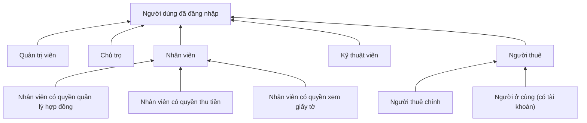

- **Người dùng đã đăng nhập** là tác nhân trừu tượng, có các use case chung: đổi mật khẩu, sửa hồ sơ, đăng xuất, nhắn tin, xem thông báo, xem dashboard.
- **Người thuê chính** là người đứng tên hợp đồng. Chỉ người thuê chính được xác nhận biên bản bàn giao (UC-40). Người ở cùng có tài khoản thì xem được hợp đồng và hóa đơn chung.
- **Nhân viên** chỉ làm được use case cần quyền thêm khi đã được chủ trọ cấp quyền đó ở UC-13.

---

## 3. Sơ đồ use case

Sơ đồ dưới đây vẽ bằng Mermaid để xem trực tiếp trên GitHub. Bản UML chuẩn (hình người, hình elip, ranh giới hệ thống) nằm ở [`docs/uml/phonghub-use-cases.puml`](uml/phonghub-use-cases.puml) và xuất ảnh bằng PlantUML.

**Cách đọc:** hình chữ nhật là tác nhân, hình viên thuốc là use case, khung là ranh giới hệ thống. Nét liền nối tác nhân với use case; nét đứt là `«include»` hoặc `«extend»`.

### 3.1. Tổng quan theo nhóm chức năng

Tác nhân nằm ngoài khung hệ thống; bên trong là 11 nhóm chức năng. Tác nhân nào dùng use case nào xem ở sơ đồ từng nhóm (3.2–3.11) và [bảng phân quyền](#6-ma-trận-phân-quyền).

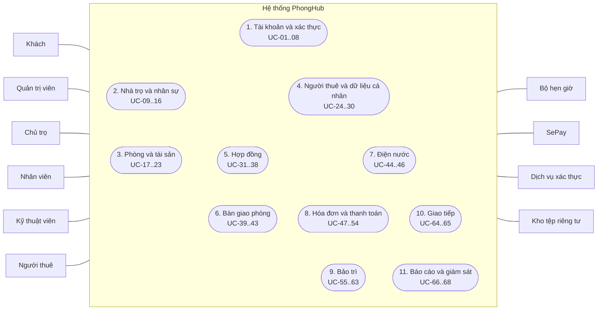

### 3.2. Tài khoản và xác thực

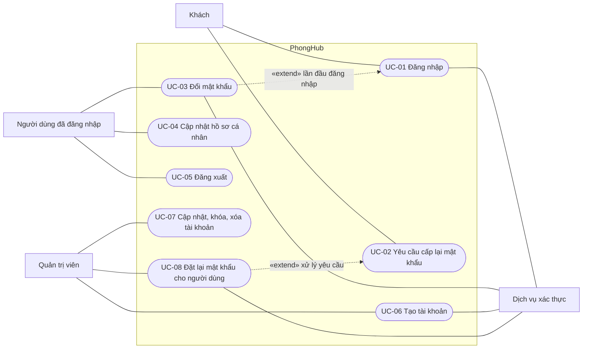

### 3.3. Nhà trọ và nhân sự

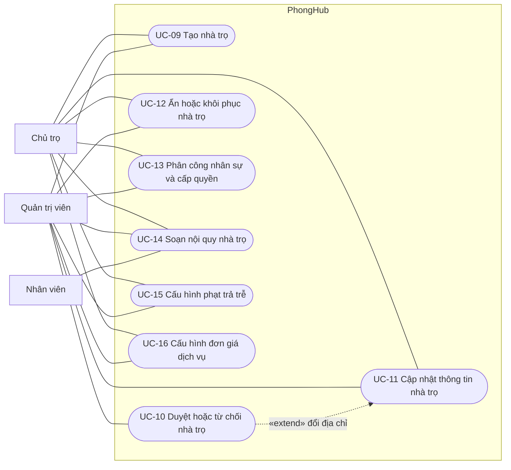

### 3.4. Phòng và tài sản

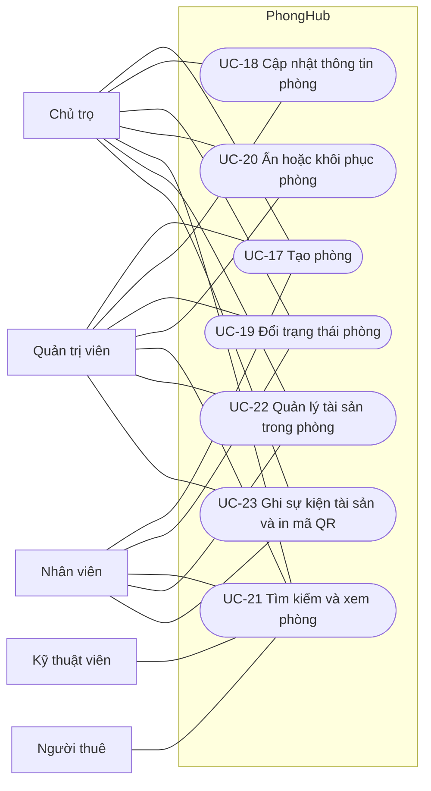

### 3.5. Người thuê và dữ liệu cá nhân

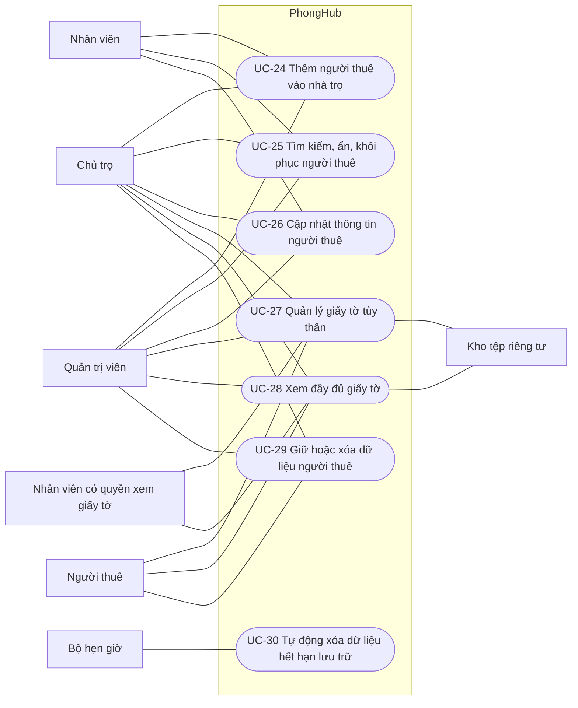

### 3.6. Hợp đồng

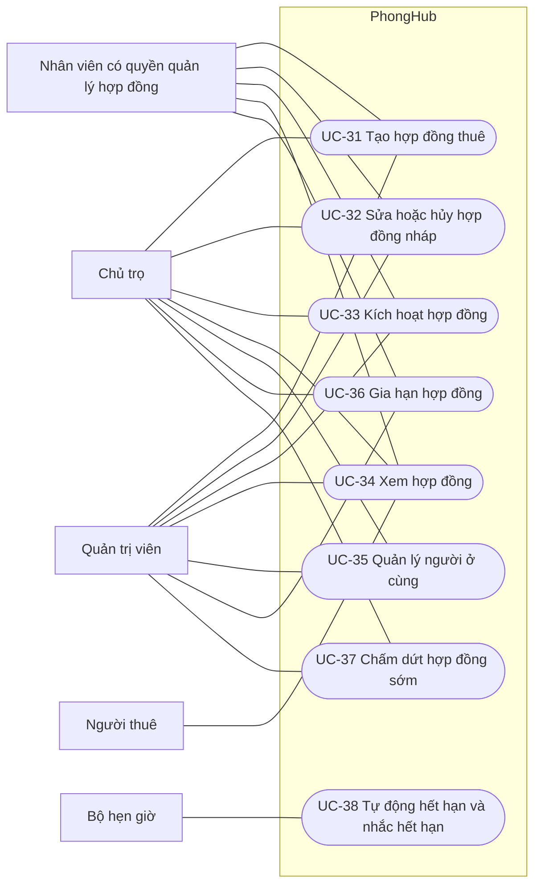

### 3.7. Bàn giao phòng

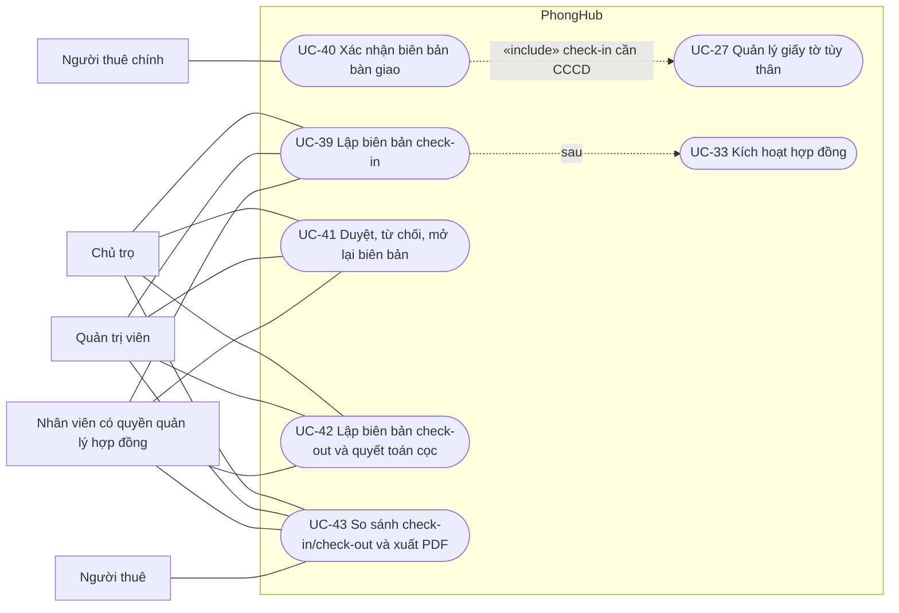

### 3.8. Điện nước

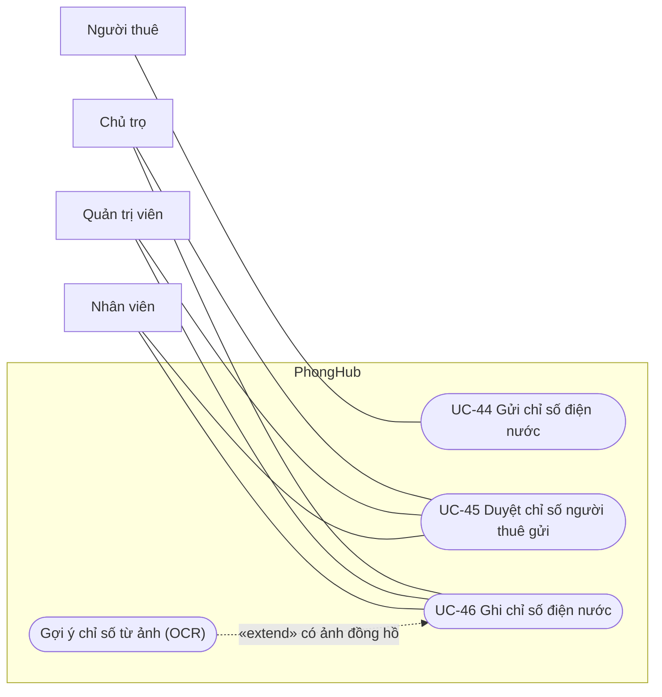

### 3.9. Hóa đơn và thanh toán

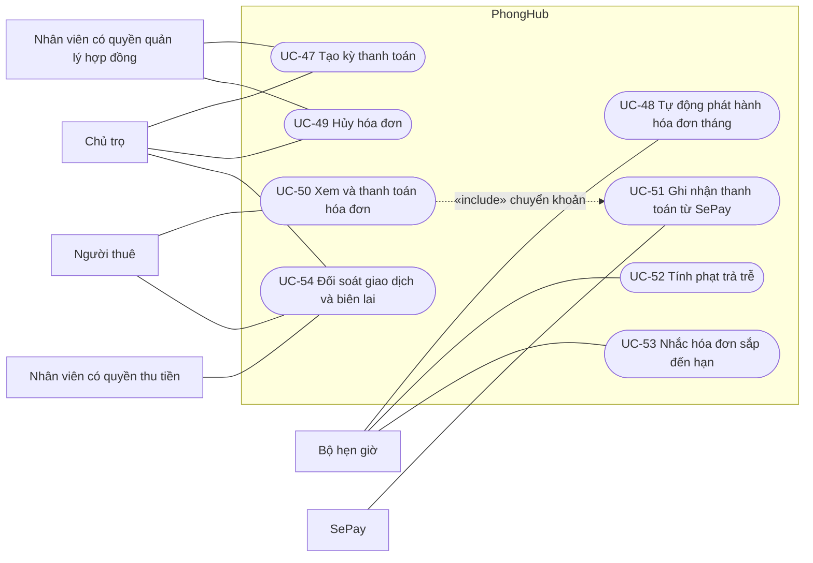

### 3.10. Bảo trì

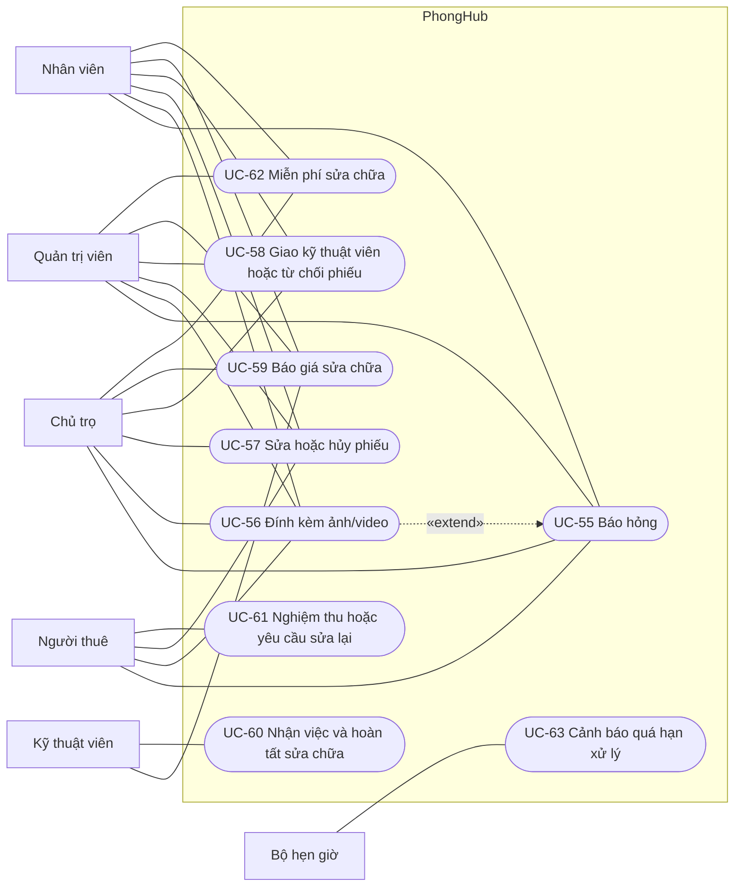

### 3.11. Giao tiếp, báo cáo và giám sát

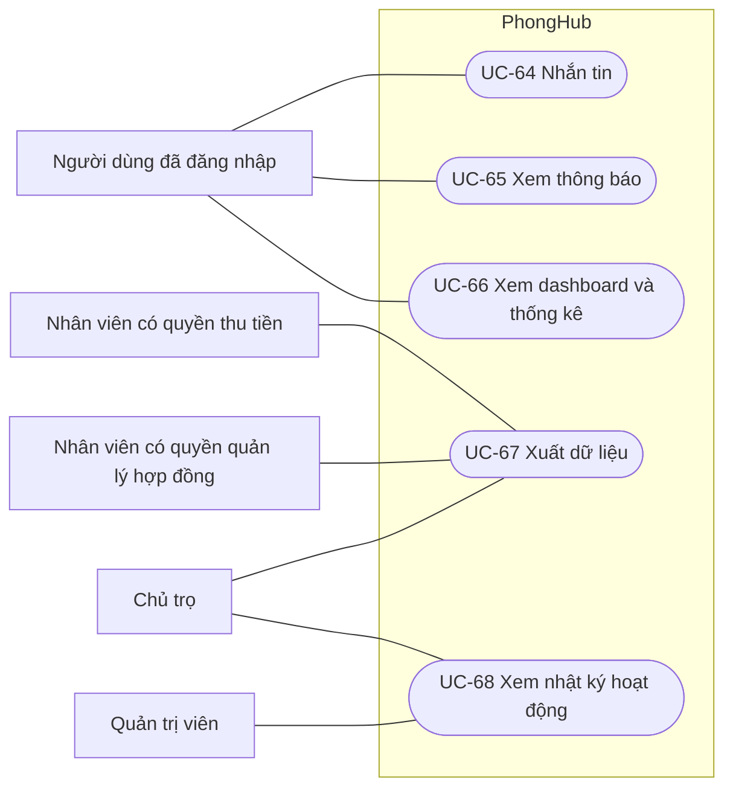

---

## 4. Danh sách use case

| Mã | Tên use case | Tác nhân chính | Tác nhân phụ | Ưu tiên |
|---|---|---|---|---|
| **1. Tài khoản và xác thực** | | | | |
| UC-01 | Đăng nhập | Khách | Dịch vụ xác thực | Cao |
| UC-02 | Yêu cầu cấp lại mật khẩu | Khách | — | Trung bình |
| UC-03 | Đổi mật khẩu | Người dùng đã đăng nhập | Dịch vụ xác thực | Cao |
| UC-04 | Cập nhật hồ sơ cá nhân | Người dùng đã đăng nhập | — | Thấp |
| UC-05 | Đăng xuất | Người dùng đã đăng nhập | — | Cao |
| UC-06 | Tạo tài khoản người dùng | Quản trị viên | Dịch vụ xác thực | Cao |
| UC-07 | Cập nhật, khóa, xóa tài khoản | Quản trị viên | Dịch vụ xác thực | Trung bình |
| UC-08 | Đặt lại mật khẩu cho người dùng | Quản trị viên | Dịch vụ xác thực | Trung bình |
| **2. Nhà trọ và nhân sự** | | | | |
| UC-09 | Tạo nhà trọ | Chủ trọ, Quản trị viên | — | Cao |
| UC-10 | Duyệt hoặc từ chối nhà trọ | Quản trị viên | — | Cao |
| UC-11 | Cập nhật thông tin nhà trọ | Chủ trọ, Quản trị viên | — | Trung bình |
| UC-12 | Ẩn hoặc khôi phục nhà trọ | Chủ trọ, Quản trị viên | — | Thấp |
| UC-13 | Phân công nhân sự và cấp quyền | Chủ trọ, Quản trị viên | — | Cao |
| UC-14 | Soạn nội quy nhà trọ | Chủ trọ, Nhân viên, Quản trị viên | — | Thấp |
| UC-15 | Cấu hình phạt trả trễ | Chủ trọ, Quản trị viên | — | Trung bình |
| UC-16 | Cấu hình đơn giá điện, nước, dịch vụ | Chủ trọ, Quản trị viên | — | Cao |
| **3. Phòng và tài sản** | | | | |
| UC-17 | Tạo phòng | Chủ trọ, Nhân viên, Quản trị viên | — | Cao |
| UC-18 | Cập nhật thông tin phòng | Chủ trọ, Quản trị viên | — | Trung bình |
| UC-19 | Đổi trạng thái phòng | Chủ trọ, Nhân viên, Quản trị viên | — | Trung bình |
| UC-20 | Ẩn hoặc khôi phục phòng | Chủ trọ, Quản trị viên | — | Thấp |
| UC-21 | Tìm kiếm và xem phòng | Mọi người dùng đã đăng nhập | — | Cao |
| UC-22 | Quản lý tài sản trong phòng | Chủ trọ, Nhân viên, Quản trị viên | Kho tệp riêng tư | Trung bình |
| UC-23 | Ghi sự kiện tài sản và in mã QR | Chủ trọ, Nhân viên, Quản trị viên | — | Thấp |
| **4. Người thuê và dữ liệu cá nhân** | | | | |
| UC-24 | Thêm người thuê vào nhà trọ | Chủ trọ, Nhân viên, Quản trị viên | — | Cao |
| UC-25 | Tìm kiếm, ẩn, khôi phục người thuê | Chủ trọ, Nhân viên, Quản trị viên | — | Trung bình |
| UC-26 | Cập nhật thông tin người thuê | Chủ trọ, Nhân viên, Quản trị viên | — | Trung bình |
| UC-27 | Quản lý giấy tờ tùy thân | Người thuê, Chủ trọ, Nhân viên có quyền xem giấy tờ, Quản trị viên | Kho tệp riêng tư | Cao |
| UC-28 | Xem đầy đủ giấy tờ | Như UC-27 | Dịch vụ xác thực, Kho tệp riêng tư | Trung bình |
| UC-29 | Giữ hoặc xóa dữ liệu người thuê | Chủ trọ, Quản trị viên, Người thuê | — | Trung bình |
| UC-30 | Tự động xóa dữ liệu hết hạn lưu trữ | Bộ hẹn giờ | Kho tệp riêng tư | Trung bình |
| **5. Hợp đồng** | | | | |
| UC-31 | Tạo hợp đồng thuê (bản nháp) | Chủ trọ, Nhân viên có quyền quản lý hợp đồng, Quản trị viên | — | Cao |
| UC-32 | Sửa hoặc hủy hợp đồng nháp | Như UC-31 | — | Trung bình |
| UC-33 | Kích hoạt hợp đồng | Như UC-31 | — | Cao |
| UC-34 | Xem hợp đồng | Người thuê, Chủ trọ, Nhân viên, Quản trị viên | — | Cao |
| UC-35 | Quản lý người ở cùng | Chủ trọ, Quản trị viên | Dịch vụ xác thực | Trung bình |
| UC-36 | Gia hạn hợp đồng | Như UC-31 | — | Trung bình |
| UC-37 | Chấm dứt hợp đồng sớm | Chủ trọ, Quản trị viên | — | Trung bình |
| UC-38 | Tự động hết hạn và nhắc hết hạn hợp đồng | Bộ hẹn giờ | — | Trung bình |
| **6. Bàn giao phòng** | | | | |
| UC-39 | Lập biên bản check-in | Chủ trọ, Nhân viên có quyền quản lý hợp đồng, Quản trị viên | Kho tệp riêng tư | Cao |
| UC-40 | Xác nhận biên bản bàn giao | Người thuê chính | — | Cao |
| UC-41 | Duyệt, từ chối, mở lại biên bản | Như UC-39 (check-out chỉ Chủ trọ, Quản trị viên duyệt) | — | Cao |
| UC-42 | Lập biên bản check-out và quyết toán tiền cọc | Như UC-39 | Kho tệp riêng tư | Cao |
| UC-43 | So sánh check-in/check-out và xuất PDF | Như UC-39, Người thuê | — | Thấp |
| **7. Điện nước** | | | | |
| UC-44 | Gửi chỉ số điện nước | Người thuê | Kho tệp riêng tư | Trung bình |
| UC-45 | Duyệt chỉ số người thuê gửi | Chủ trọ, Nhân viên, Quản trị viên | — | Trung bình |
| UC-46 | Ghi chỉ số điện nước | Chủ trọ, Nhân viên, Quản trị viên | Kho tệp riêng tư | Cao |
| **8. Hóa đơn và thanh toán** | | | | |
| UC-47 | Tạo kỳ thanh toán | Chủ trọ, Nhân viên có quyền quản lý hợp đồng | — | Cao |
| UC-48 | Tự động phát hành hóa đơn tháng | Bộ hẹn giờ | — | Cao |
| UC-49 | Hủy hóa đơn | Chủ trọ, Nhân viên có quyền quản lý hợp đồng | — | Trung bình |
| UC-50 | Xem và thanh toán hóa đơn | Người thuê | SePay | Cao |
| UC-51 | Ghi nhận thanh toán từ SePay | SePay | — | Cao |
| UC-52 | Tính phạt trả trễ | Bộ hẹn giờ | — | Trung bình |
| UC-53 | Nhắc hóa đơn sắp đến hạn | Bộ hẹn giờ | — | Trung bình |
| UC-54 | Đối soát giao dịch và xem biên lai | Chủ trọ, Nhân viên có quyền thu tiền, Người thuê | — | Trung bình |
| **9. Bảo trì** | | | | |
| UC-55 | Báo hỏng (tạo phiếu bảo trì) | Người thuê, Chủ trọ, Nhân viên, Quản trị viên | — | Cao |
| UC-56 | Đính kèm ảnh/video vào phiếu | Người thuê, Chủ trọ, Nhân viên, Quản trị viên | Kho tệp riêng tư | Trung bình |
| UC-57 | Sửa hoặc hủy phiếu | Người báo hỏng, Chủ trọ, Nhân viên, Quản trị viên | — | Thấp |
| UC-58 | Giao kỹ thuật viên hoặc từ chối phiếu | Chủ trọ, Nhân viên, Quản trị viên | — | Cao |
| UC-59 | Báo giá sửa chữa | Kỹ thuật viên được giao, Chủ trọ, Nhân viên, Quản trị viên | — | Trung bình |
| UC-60 | Nhận việc và hoàn tất sửa chữa | Kỹ thuật viên được giao | — | Cao |
| UC-61 | Nghiệm thu hoặc yêu cầu sửa lại | Người thuê | — | Cao |
| UC-62 | Miễn phí sửa chữa | Chủ trọ, Nhân viên, Quản trị viên | — | Thấp |
| UC-63 | Cảnh báo quá hạn xử lý (SLA) | Bộ hẹn giờ | — | Trung bình |
| **10. Giao tiếp** | | | | |
| UC-64 | Nhắn tin | Người dùng đã đăng nhập | — | Trung bình |
| UC-65 | Xem thông báo | Người dùng đã đăng nhập | — | Trung bình |
| **11. Báo cáo và giám sát** | | | | |
| UC-66 | Xem dashboard và thống kê | Người dùng đã đăng nhập | — | Trung bình |
| UC-67 | Xuất dữ liệu (Excel, PDF, CSV) | Chủ trọ, Nhân viên có quyền quản lý hợp đồng hoặc thu tiền | — | Thấp |
| UC-68 | Xem nhật ký hoạt động | Quản trị viên, Chủ trọ | — | Trung bình |

---

## 5. Đặc tả chi tiết

Mỗi use case gồm: thông tin chung, **luồng chính** (các bước đánh số), **luồng thay thế** (`Na` rẽ từ bước N), **ngoại lệ** (`En`, use case kết thúc không thành công) và **quy tắc nghiệp vụ** (`BR`). Lỗi chung E-401, E-403, E-409, E-429 ở [mục 1.3](#13-quy-ước) không nhắc lại.

### 5.1. Tài khoản và xác thực

#### UC-01. Đăng nhập

| Mục | Nội dung |
|---|---|
| Tác nhân chính | Khách |
| Tác nhân phụ | Dịch vụ xác thực |
| Mô tả | Người dùng đăng nhập bằng tên đăng nhập hoặc email và mật khẩu để dùng chức năng theo vai trò. |
| Kích hoạt | Mở `/login`, hoặc truy cập trang cần đăng nhập khi chưa đăng nhập. |
| Tiền điều kiện | Tài khoản đã được tạo (UC-06, hoặc cấp kèm khi thêm người ở cùng ở UC-35). |
| Hậu điều kiện (thành công) | Phiên đăng nhập được tạo (lưu ở Redis, không mất khi ứng dụng khởi động lại); người dùng vào trang chủ đúng vai trò. API trả access token và refresh token. |
| Hậu điều kiện (thất bại) | Không tạo phiên. |
| Quan hệ | UC-03 `«extend»` UC-01 khi tài khoản phải đổi mật khẩu lần đầu. |
| Kênh | Web `/login`; API `POST /api/auth/login`, `POST /api/auth/refresh` |

**Luồng chính**
1. Khách nhập tên đăng nhập hoặc email và mật khẩu.
2. Hệ thống kiểm tra giới hạn số lần thử đăng nhập.
3. Hệ thống gửi mật khẩu tới dịch vụ xác thực để kiểm tra.
4. Hệ thống kiểm tra tài khoản đang ở trạng thái `ACTIVE`.
5. Hệ thống tạo phiên và chuyển tới trang chủ theo vai trò (UC-66).

**Luồng thay thế**
- 5a. Tài khoản đang bật cờ *phải đổi mật khẩu*: hệ thống chuyển tới trang đổi mật khẩu (UC-03) và chặn các trang khác tới khi đổi xong.

**Ngoại lệ**
- E1. Sai tên đăng nhập hoặc mật khẩu: báo chung "Sai tên đăng nhập hoặc mật khẩu", không cho biết tài khoản có tồn tại hay không.
- E2. Tài khoản `INACTIVE` hoặc `SUSPENDED`: từ chối đăng nhập. Trạng thái chỉ được kiểm tra *sau* khi mật khẩu đúng, nên người ngoài không dò được tài khoản nào đang bị khóa.
- E3. Vượt giới hạn số lần thử: E-429.

**Quy tắc nghiệp vụ**
- BR1. Không có chức năng tự đăng ký. Mọi tài khoản do quản trị viên tạo, hoặc do chủ trọ cấp cho người ở cùng.

#### UC-02. Yêu cầu cấp lại mật khẩu

| Mục | Nội dung |
|---|---|
| Tác nhân chính | Khách |
| Mô tả | Người dùng quên mật khẩu gửi yêu cầu để quản trị viên cấp mật khẩu tạm. |
| Kích hoạt | Chọn "Quên mật khẩu" ở trang đăng nhập (`/forgot-password`). |
| Tiền điều kiện | Không có. |
| Hậu điều kiện | Nếu tài khoản tồn tại (và không phải quản trị viên), một thông báo yêu cầu đặt lại mật khẩu được gửi tới quản trị viên. |
| Quan hệ | Được xử lý tiếp ở UC-08. |

**Luồng chính**
1. Khách nhập tên đăng nhập hoặc email.
2. Hệ thống tìm tài khoản và tạo thông báo yêu cầu đặt lại mật khẩu cho quản trị viên.
3. Hệ thống luôn hiện cùng một thông báo trung tính ("Nếu tài khoản tồn tại, quản trị viên sẽ liên hệ…").

**Ngoại lệ**
- E1. Ô nhập để trống: báo "Vui lòng nhập tên đăng nhập hoặc email".
- E2. Gửi quá nhiều lần: E-429.

**Quy tắc nghiệp vụ**
- BR1. Không tiết lộ tài khoản có tồn tại hay không: tài khoản không tồn tại cũng nhận cùng thông báo ở bước 3.
- BR2. Tài khoản quản trị viên không tạo yêu cầu (quản trị viên tự xử lý trên dịch vụ xác thực).

#### UC-03. Đổi mật khẩu

| Mục | Nội dung |
|---|---|
| Tác nhân chính | Người dùng đã đăng nhập |
| Tác nhân phụ | Dịch vụ xác thực |
| Mô tả | Người dùng đổi mật khẩu của mình; bắt buộc ở lần đăng nhập đầu tiên hoặc sau khi được cấp mật khẩu tạm. |
| Tiền điều kiện | Đã đăng nhập (phiên đăng nhập là bằng chứng xác thực, không hỏi lại mật khẩu cũ). |
| Hậu điều kiện | Mật khẩu mới có hiệu lực; cờ *phải đổi mật khẩu* được tắt ngay trong phiên hiện tại. |
| Kênh | Web `/account/password`; API `POST /api/auth/change-password` |

**Luồng chính**
1. Người dùng nhập mật khẩu mới.
2. Hệ thống kiểm tra độ dài tối thiểu (8 ký tự).
3. Hệ thống cập nhật mật khẩu ở dịch vụ xác thực, tắt cờ *phải đổi mật khẩu*.
4. Hệ thống chuyển về trang chủ.

**Ngoại lệ**
- E1. Mật khẩu mới ngắn hơn 8 ký tự: báo lỗi, không đổi.
- E2. Dịch vụ xác thực tạm thời không phản hồi: báo "Dịch vụ xác thực tạm thời không khả dụng", không đổi.

#### UC-04. Cập nhật hồ sơ cá nhân

| Mục | Nội dung |
|---|---|
| Tác nhân chính | Người dùng đã đăng nhập |
| Mô tả | Người dùng sửa họ tên và số điện thoại của chính mình. |
| Tiền điều kiện | Đã đăng nhập. |
| Hậu điều kiện | Hồ sơ được cập nhật. |
| Kênh | Web `/account/profile` |

**Luồng chính**
1. Người dùng mở trang hồ sơ, sửa thông tin.
2. Hệ thống kiểm tra định dạng (số điện thoại 10 số, bắt đầu bằng 0) và lưu.

**Ngoại lệ**
- E1. Sửa hồ sơ của người khác (không phải quản trị viên): E-403.
- E2. Dữ liệu sai định dạng: báo lỗi.

#### UC-05. Đăng xuất

| Mục | Nội dung |
|---|---|
| Tác nhân chính | Người dùng đã đăng nhập |
| Mô tả | Kết thúc phiên làm việc. |
| Hậu điều kiện | Phiên bị hủy. Với API, hệ thống báo dịch vụ xác thực đăng xuất access token. |
| Kênh | Web `/session/logout`; API `POST /api/auth/logout` |

**Luồng chính**
1. Người dùng chọn "Đăng xuất".
2. Hệ thống hủy phiên và chuyển về trang đăng nhập.

#### UC-06. Tạo tài khoản người dùng

| Mục | Nội dung |
|---|---|
| Tác nhân chính | Quản trị viên |
| Tác nhân phụ | Dịch vụ xác thực |
| Mô tả | Quản trị viên tạo tài khoản cho chủ trọ, nhân viên, kỹ thuật viên hoặc người thuê; hệ thống sinh mật khẩu tạm. |
| Tiền điều kiện | Đăng nhập với vai trò quản trị viên. |
| Hậu điều kiện | Tài khoản `ACTIVE` được tạo với cờ *phải đổi mật khẩu*; mật khẩu tạm hiện **một lần** để quản trị viên gửi cho người dùng. |
| Kênh | Web `/admin/users`; API `POST /api/admin/users` |

**Luồng chính**
1. Quản trị viên nhập tên đăng nhập, email, họ tên, số điện thoại (không bắt buộc) và chọn vai trò.
2. Hệ thống kiểm tra dữ liệu (BR1–BR3).
3. Hệ thống tạo danh tính ở dịch vụ xác thực với mật khẩu tạm 16 ký tự.
4. Hệ thống lưu tài khoản và ghi nhật ký `ADMIN_CREATE_USER`.
5. Hệ thống hiện tên đăng nhập và mật khẩu tạm.

**Ngoại lệ**
- E1. Tên đăng nhập, email hoặc số điện thoại đã được dùng: báo trùng.
- E2. Lưu cơ sở dữ liệu thất bại: hệ thống xóa danh tính vừa tạo ở dịch vụ xác thực (bù trừ) để không để lại tài khoản mồ côi, rồi báo lỗi.

**Quy tắc nghiệp vụ**
- BR1. Tên đăng nhập 3–50 ký tự, chỉ gồm chữ thường, số, `.`, `_`, `-`.
- BR2. Vai trò được tạo từ giao diện: `OWNER`, `STAFF`, `TECHNICIAN`, `TENANT`. Không tạo `ADMIN`.
- BR3. Tài khoản `TENANT` tạo ở đây chưa gắn với hồ sơ người thuê. Hồ sơ được tạo hoặc gắn khi chọn tài khoản này lúc lập hợp đồng (UC-31).

#### UC-07. Cập nhật, khóa, xóa tài khoản

| Mục | Nội dung |
|---|---|
| Tác nhân chính | Quản trị viên |
| Tác nhân phụ | Dịch vụ xác thực |
| Mô tả | Sửa thông tin, đổi vai trò, đổi trạng thái (`ACTIVE`, `INACTIVE`, `SUSPENDED`) hoặc xóa tài khoản. |
| Tiền điều kiện | Đăng nhập với vai trò quản trị viên; tài khoản đích tồn tại. |
| Hậu điều kiện | Tài khoản được cập nhật hoặc bị xóa; có nhật ký. |
| Kênh | Web `/admin/users/{id}/edit`, `/admin/users/{id}/delete`; API `PATCH/DELETE /api/admin/users/{id}` |

**Luồng chính (cập nhật)**
1. Quản trị viên mở trang sửa tài khoản, đổi thông tin, vai trò hoặc trạng thái.
2. Hệ thống kiểm tra BR1–BR2 và lưu.

**Luồng thay thế (xóa)**
- 1a. Quản trị viên chọn "Xóa": hệ thống xóa danh tính ở dịch vụ xác thực trước, thành công mới xóa trong cơ sở dữ liệu và ghi nhật ký `ADMIN_DELETE_USER`.

**Ngoại lệ**
- E1. Tài khoản đích là quản trị viên, hoặc quản trị viên tự xóa chính mình: từ chối.
- E2. Đổi vai trò khi tài khoản còn sở hữu nhà trọ hoặc còn được phân công: báo xung đột (E-409), yêu cầu chuyển giao trước.
- E3. Xóa ở dịch vụ xác thực thất bại: dừng, không xóa trong cơ sở dữ liệu.

**Quy tắc nghiệp vụ**
- BR1. Không cấp vai trò `ADMIN` qua chức năng này.
- BR2. Tài khoản `INACTIVE` hoặc `SUSPENDED` không đăng nhập được (UC-01, E2).

#### UC-08. Đặt lại mật khẩu cho người dùng

| Mục | Nội dung |
|---|---|
| Tác nhân chính | Quản trị viên |
| Tác nhân phụ | Dịch vụ xác thực |
| Mô tả | Cấp mật khẩu tạm mới cho người dùng, thường để xử lý yêu cầu ở UC-02. |
| Kích hoạt | Từ danh sách tài khoản, hoặc từ thông báo "yêu cầu đặt lại mật khẩu" (`/admin/notifications`). |
| Hậu điều kiện | Mật khẩu tạm mới có hiệu lực; tài khoản phải đổi mật khẩu ở lần đăng nhập sau; thông báo yêu cầu được đánh dấu đã xử lý. |
| Kênh | Web `/admin/users/{id}/reset-password`, `/admin/notifications/{id}/reset-password`; API `POST /api/admin/users/{id}/password-reset` |

**Luồng chính**
1. Quản trị viên chọn "Đặt lại mật khẩu".
2. Hệ thống sinh mật khẩu tạm, cập nhật ở dịch vụ xác thực, bật cờ *phải đổi mật khẩu*.
3. Hệ thống hiện mật khẩu tạm một lần để quản trị viên gửi cho người dùng.

**Luồng thay thế**
- 1a. Quản trị viên chỉ đánh dấu đã xử lý hoặc xóa thông báo yêu cầu mà không đặt lại mật khẩu.

**Ngoại lệ**
- E1. Tài khoản đích là quản trị viên: từ chối.

### 5.2. Nhà trọ và nhân sự

#### UC-09. Tạo nhà trọ

| Mục | Nội dung |
|---|---|
| Tác nhân chính | Chủ trọ, Quản trị viên |
| Mô tả | Khai báo một nhà trọ mới (tên, địa chỉ, mô tả, tổng số phòng). |
| Tiền điều kiện | Đăng nhập với vai trò chủ trọ hoặc quản trị viên. |
| Hậu điều kiện | Chủ trọ tạo: nhà trọ thuộc chủ trọ đó, trạng thái `PENDING` chờ duyệt. Quản trị viên tạo: nhà trọ `VERIFIED` ngay. |
| Kênh | Web `/properties`; API `POST /api/properties` |

**Luồng chính**
1. Tác nhân nhập thông tin nhà trọ.
2. Hệ thống kiểm tra dữ liệu và lưu.
3. Nhà trọ hiện trong danh sách kèm trạng thái duyệt.

**Ngoại lệ**
- E1. Vai trò khác (nhân viên, kỹ thuật viên, người thuê): E-403.

**Quy tắc nghiệp vụ**
- BR1. Nhà trọ chưa `VERIFIED` thì chưa tạo được hợp đồng (UC-31) và chưa thêm người ở cùng (UC-35).

#### UC-10. Duyệt hoặc từ chối nhà trọ

| Mục | Nội dung |
|---|---|
| Tác nhân chính | Quản trị viên |
| Mô tả | Kiểm tra nhà trọ chủ trọ khai báo rồi duyệt hoặc từ chối. |
| Tiền điều kiện | Nhà trọ ở trạng thái `PENDING` và không bị ẩn. |
| Hậu điều kiện | `VERIFIED` (được kinh doanh) hoặc `REJECTED` (kèm lý do). |
| Quan hệ | `«extend»` UC-11: nhà trọ đã duyệt đổi địa chỉ thì quay lại `PENDING` và phải duyệt lại. |
| Kênh | Web `/properties/{id}/verify`, `/properties/{id}/reject`; API `/api/admin/properties/{id}/verify`, `/reject` |

**Luồng chính**
1. Quản trị viên mở danh sách nhà trọ chờ duyệt (dashboard quản trị, UC-66).
2. Quản trị viên xem thông tin, chọn "Duyệt" hoặc "Từ chối" (nhập lý do).
3. Hệ thống cập nhật trạng thái và ghi nhật ký.

**Ngoại lệ**
- E1. Nhà trọ đã bị ẩn: từ chối duyệt.

#### UC-11. Cập nhật thông tin nhà trọ

| Mục | Nội dung |
|---|---|
| Tác nhân chính | Chủ trọ, Quản trị viên |
| Mô tả | Sửa tên, địa chỉ, mô tả, tổng số phòng. |
| Tiền điều kiện | Nhà trọ của mình, chưa bị ẩn. |
| Hậu điều kiện | Thông tin được cập nhật; nếu chủ trọ đổi địa chỉ của nhà trọ đã duyệt thì nhà trọ quay về `PENDING`. |
| Kênh | Web `/properties/{id}/edit`; API `PUT /api/properties/{id}` |

**Luồng chính**
1. Tác nhân sửa thông tin và lưu.
2. Hệ thống kiểm tra BR1 và lưu, ghi nhật ký.

**Luồng thay thế**
- 2a. Chủ trọ đổi địa chỉ của nhà trọ `VERIFIED`: hệ thống chuyển nhà trọ về `PENDING` để quản trị viên duyệt lại (UC-10). Sửa tên, mô tả, số phòng không phải duyệt lại.

**Ngoại lệ**
- E1. Tổng số phòng nhỏ hơn số phòng đã tạo: báo lỗi.
- E2. Nhà trọ đã bị ẩn: từ chối sửa.

#### UC-12. Ẩn hoặc khôi phục nhà trọ

| Mục | Nội dung |
|---|---|
| Tác nhân chính | Chủ trọ, Quản trị viên |
| Mô tả | Ngừng kinh doanh nhà trọ (ẩn khỏi danh sách, giữ lịch sử) hoặc khôi phục. |
| Tiền điều kiện | Nhà trọ của mình. |
| Hậu điều kiện | Nhà trọ bị ẩn: không tạo được hợp đồng, không sửa được; dữ liệu cũ vẫn giữ. |
| Kênh | Web `/properties/{id}/archive`, `/restore`; API tương ứng |

**Luồng chính**
1. Tác nhân chọn "Ẩn nhà trọ" và xác nhận.
2. Hệ thống kiểm tra BR1 và ẩn nhà trọ.

**Ngoại lệ**
- E1. Còn hợp đồng chưa kết thúc (nháp, đang hiệu lực, hết hạn nhưng chưa trả phòng): từ chối, báo số hợp đồng còn mở.
- E2. Còn hóa đơn chưa thu xong: từ chối, yêu cầu thu đủ hoặc hủy hóa đơn trước.
- E3. Nhà trọ đã ẩn từ trước: báo xung đột.

#### UC-13. Phân công nhân sự và cấp quyền

| Mục | Nội dung |
|---|---|
| Tác nhân chính | Chủ trọ, Quản trị viên |
| Mô tả | Gán nhân viên hoặc kỹ thuật viên vào nhà trọ, cấp hoặc thu quyền, gỡ phân công. |
| Tiền điều kiện | Nhà trọ của mình; người được gán đã có tài khoản `STAFF` hoặc `TECHNICIAN`. |
| Hậu điều kiện | Người được gán thấy nhà trọ trong phạm vi của mình, với đúng các quyền được cấp. |
| Kênh | Web `/properties/{id}/staff`; API `/api/properties/{id}/staff` |

**Luồng chính**
1. Tác nhân nhập tên đăng nhập hoặc email của người cần gán.
2. Hệ thống kiểm tra vai trò của tài khoản (BR1) và tạo phân công.
3. Với nhân viên, tác nhân bật hoặc tắt từng quyền: *quản lý hợp đồng*, *thu tiền*, *xem giấy tờ*.
4. Hệ thống lưu và ghi nhật ký.

**Luồng thay thế**
- 1a. Gỡ phân công: tác nhân chọn "Gỡ", hệ thống xóa phân công; người đó mất quyền truy cập nhà trọ ngay.

**Ngoại lệ**
- E1. Tài khoản không phải `STAFF` hoặc `TECHNICIAN`: từ chối.
- E2. Cấp quyền tiền, hợp đồng hoặc giấy tờ cho kỹ thuật viên: từ chối.

**Quy tắc nghiệp vụ**
- BR1. Chỉ phân công được tài khoản `STAFF` hoặc `TECHNICIAN`.
- BR2. Kỹ thuật viên phải được phân công vào nhà trọ thì mới hiện trong danh sách giao việc ở UC-58.

#### UC-14. Soạn nội quy nhà trọ

| Mục | Nội dung |
|---|---|
| Tác nhân chính | Chủ trọ, Nhân viên, Quản trị viên |
| Mô tả | Soạn nội quy chung của nhà trọ; nội quy được gửi kèm biên bản bàn giao để người thuê đọc và xác nhận. |
| Tiền điều kiện | Nhà trọ của mình (với nhân viên: nhà trọ được phân công). |
| Hậu điều kiện | Nội quy mới được lưu. Biên bản đã gửi vẫn giữ bản nội quy và mã băm tại lúc gửi. |
| Kênh | Web `/contracts/{id}/handover/house-rules`; API `GET/PUT /api/properties/{id}/house-rules` |

**Luồng chính**
1. Tác nhân soạn hoặc sửa nội quy và lưu.
2. Hệ thống lưu nội quy cho nhà trọ.

#### UC-15. Cấu hình phạt trả trễ

| Mục | Nội dung |
|---|---|
| Tác nhân chính | Chủ trọ, Quản trị viên |
| Mô tả | Bật/tắt phạt trả trễ của nhà trọ: phạt theo % hoặc số tiền cố định, số ngày ân hạn, mức phạt tối đa. |
| Tiền điều kiện | Nhà trọ của mình. |
| Hậu điều kiện | Chính sách được lưu; UC-52 dùng chính sách này ở lần chạy sau. |
| Kênh | Web `/properties/{id}/late-fee` |

**Luồng chính**
1. Tác nhân chọn bật phạt, loại phạt, mức phạt, số ngày ân hạn, mức tối đa (không bắt buộc).
2. Hệ thống kiểm tra BR1 và lưu.

**Quy tắc nghiệp vụ**
- BR1. Mức phạt không âm; phạt theo % không vượt 100%; ân hạn từ 0 đến 365 ngày; đã bật thì mức phạt phải lớn hơn 0.

#### UC-16. Cấu hình đơn giá điện, nước, dịch vụ

| Mục | Nội dung |
|---|---|
| Tác nhân chính | Chủ trọ, Quản trị viên |
| Mô tả | Khai báo đơn giá điện (theo kWh), nước (theo m³), dịch vụ cố định theo phòng hoặc theo người. |
| Tiền điều kiện | Nhà trọ của mình. |
| Hậu điều kiện | Đơn giá được dùng khi tính hóa đơn (UC-47, UC-48) và quyết toán trả phòng (UC-42). |
| Kênh | **Chỉ có API**: `POST/GET /api/properties/{id}/service-rates`, `PUT /api/service-rates/{id}` |

**Luồng chính**
1. Tác nhân gửi tên khoản, loại tính (`PER_KWH`, `PER_PERSON`, `PER_ROOM_FLAT`) và đơn giá.
2. Hệ thống lưu đơn giá.

**Quy tắc nghiệp vụ**
- BR1. Chưa có đơn giá thì hóa đơn không có dòng điện nước, và trang hợp đồng cảnh báo "nhà trọ chưa cấu hình đơn giá".
- BR2. Dịch vụ cố định chỉ tính lúc phát hành hóa đơn; đơn giá thêm sau không làm đổi hóa đơn đã phát hành.

### 5.3. Phòng và tài sản

#### UC-17. Tạo phòng

| Mục | Nội dung |
|---|---|
| Tác nhân chính | Chủ trọ, Nhân viên, Quản trị viên |
| Mô tả | Thêm phòng vào nhà trọ (số phòng, tầng, diện tích, giá, sức chứa). |
| Tiền điều kiện | Nhà trọ của mình, đã `VERIFIED` và chưa bị ẩn. |
| Hậu điều kiện | Phòng mới ở trạng thái `AVAILABLE`. |
| Kênh | Web `/properties/{id}/rooms`; API `POST /api/properties/{id}/rooms` |

**Luồng chính**
1. Tác nhân nhập số phòng, tầng, diện tích, giá cơ bản, số người tối đa.
2. Hệ thống kiểm tra dữ liệu và lưu phòng.

**Ngoại lệ**
- E1. Trùng số phòng trong cùng nhà trọ (kể cả phòng đã ngừng sử dụng): báo trùng.
- E2. Nhà trọ chưa duyệt hoặc đã bị ẩn: từ chối.

#### UC-18. Cập nhật thông tin phòng

| Mục | Nội dung |
|---|---|
| Tác nhân chính | Chủ trọ, Quản trị viên |
| Mô tả | Sửa số phòng, tầng, diện tích, giá, sức chứa. |
| Tiền điều kiện | Phòng thuộc nhà trọ của mình, chưa bị ẩn. |
| Hậu điều kiện | Thông tin phòng được cập nhật (không đổi hợp đồng đang có). |
| Kênh | Web `/rooms/{id}/edit`; API `PUT /api/rooms/{id}` |

**Luồng chính**
1. Tác nhân sửa thông tin và lưu.
2. Hệ thống kiểm tra dữ liệu và lưu.

#### UC-19. Đổi trạng thái phòng

| Mục | Nội dung |
|---|---|
| Tác nhân chính | Chủ trọ, Nhân viên, Quản trị viên |
| Mô tả | Đổi tay trạng thái phòng giữa `AVAILABLE`, `RESERVED` (giữ chỗ), `MAINTENANCE` (bảo trì). |
| Tiền điều kiện | Phòng thuộc nhà trọ của mình, chưa bị ẩn. |
| Hậu điều kiện | Trạng thái phòng thay đổi. |
| Kênh | Web `/rooms/{id}/status`; API `PATCH /api/rooms/{id}/status` |

**Luồng chính**
1. Tác nhân chọn trạng thái mới.
2. Hệ thống kiểm tra BR1 và cập nhật.

**Ngoại lệ**
- E1. Phòng đang có người ở theo hợp đồng: không đổi tay được, báo lý do.

**Quy tắc nghiệp vụ**
- BR1. `OCCUPIED` chỉ do hệ thống đặt khi kích hoạt hợp đồng (UC-33); kết thúc hợp đồng thì phòng về `AVAILABLE` hoặc `MAINTENANCE` (UC-37, UC-42).

#### UC-20. Ẩn hoặc khôi phục phòng

| Mục | Nội dung |
|---|---|
| Tác nhân chính | Chủ trọ, Quản trị viên |
| Mô tả | Ngừng sử dụng phòng (ẩn khỏi danh sách, giữ lịch sử) hoặc dùng lại. |
| Tiền điều kiện | Phòng thuộc nhà trọ của mình. |
| Hậu điều kiện | Phòng bị ẩn không tạo được hợp đồng và không sửa được. |
| Kênh | Web `/rooms/{id}/archive`, `/restore`; API tương ứng |

**Luồng chính**
1. Tác nhân chọn "Ngừng sử dụng" và xác nhận.
2. Hệ thống kiểm tra phòng không còn hợp đồng mở rồi ẩn phòng.

**Ngoại lệ**
- E1. Phòng còn hợp đồng chưa kết thúc: từ chối.

#### UC-21. Tìm kiếm và xem phòng

| Mục | Nội dung |
|---|---|
| Tác nhân chính | Chủ trọ, Nhân viên, Kỹ thuật viên, Quản trị viên, Người thuê |
| Mô tả | Xem danh sách phòng của nhà trọ, lọc theo trạng thái, khoảng giá, tầng; xem chi tiết phòng. |
| Tiền điều kiện | Nhà trọ trong phạm vi của mình. |
| Hậu điều kiện | Không đổi dữ liệu. |
| Kênh | Web `/properties/{id}`, `/rooms/{id}`; API `GET /api/properties/{id}/rooms`, `GET /api/rooms/{id}` |

**Luồng chính**
1. Tác nhân mở nhà trọ và nhập điều kiện lọc.
2. Hệ thống trả danh sách phòng phân trang theo điều kiện.
3. Tác nhân mở chi tiết một phòng: thông tin, tài sản, hợp đồng, phiếu bảo trì (theo quyền).

**Quy tắc nghiệp vụ**
- BR1. Người thuê chỉ thấy phòng mình đang ở.

#### UC-22. Quản lý tài sản trong phòng

| Mục | Nội dung |
|---|---|
| Tác nhân chính | Chủ trọ, Nhân viên, Quản trị viên |
| Tác nhân phụ | Kho tệp riêng tư |
| Mô tả | Thêm, sửa, xóa tài sản (tên, số lượng, tình trạng, giá trị, ảnh) của phòng; thêm từ danh sách mẫu; thêm cùng lúc cho nhiều phòng. |
| Tiền điều kiện | Phòng thuộc nhà trọ của mình. |
| Hậu điều kiện | Danh sách tài sản được cập nhật. Biên bản bàn giao lập sau đó lấy danh sách này làm mục kiểm tra. |
| Kênh | Web `/rooms/{id}/assets…`; API `/api/rooms/{id}/assets…`, `/api/assets/{id}` |

**Luồng chính**
1. Tác nhân mở tab tài sản của phòng và chọn "Thêm tài sản".
2. Tác nhân nhập thông tin (kèm ảnh nếu có).
3. Hệ thống lưu tài sản; ảnh được lưu ở kho riêng tư, chỉ xem qua đường dẫn có ký hạn.

**Luồng thay thế**
- 1a. Thêm từ mẫu: chọn mẫu *Cơ bản* hoặc *Đầy đủ*, hệ thống tạo sẵn các tài sản thường gặp.
- 1b. Thêm theo lô: tác nhân chọn nhiều phòng, hệ thống tạo cùng một tài sản cho từng phòng.
- 1c. Sửa hoặc xóa tài sản đã có.

#### UC-23. Ghi sự kiện tài sản và in mã QR

| Mục | Nội dung |
|---|---|
| Tác nhân chính | Chủ trọ, Nhân viên, Quản trị viên |
| Mô tả | Ghi lịch sử tài sản (hỏng, sửa, thay mới…), có thể gắn với phiếu bảo trì của cùng phòng; xem lịch sử; tạo mã QR dán lên tài sản. |
| Tiền điều kiện | Tài sản thuộc phòng của nhà trọ mình. |
| Hậu điều kiện | Sự kiện được thêm vào lịch sử tài sản. |
| Kênh | Web `/rooms/{id}/assets/{assetId}/events`, `/qr`; API `/api/assets/{id}/events`, `/qr` |

**Luồng chính**
1. Tác nhân chọn tài sản, chọn "Ghi sự kiện", nhập loại sự kiện và ghi chú.
2. Hệ thống lưu sự kiện vào lịch sử.

**Ngoại lệ**
- E1. Phiếu bảo trì được gắn không thuộc phòng của tài sản: từ chối.

### 5.4. Người thuê và dữ liệu cá nhân

#### UC-24. Thêm người thuê vào nhà trọ

| Mục | Nội dung |
|---|---|
| Tác nhân chính | Chủ trọ, Nhân viên, Quản trị viên |
| Mô tả | Tạo hồ sơ người thuê (họ tên, CCCD, số điện thoại, email, địa chỉ thường trú) và gắn vào nhà trọ. |
| Tiền điều kiện | Nhà trọ của mình. |
| Hậu điều kiện | Hồ sơ được tạo; CCCD, số điện thoại, email, địa chỉ được mã hóa khi lưu; nhật ký `TENANT_CREATED` chỉ ghi CCCD đã che. |
| Kênh | Web `/properties/{id}/tenants/new`; API `POST /api/properties/{id}/tenants` |

**Luồng chính**
1. Tác nhân nhập thông tin người thuê.
2. Hệ thống kiểm tra định dạng (BR1) và tìm CCCD đã có hay chưa (qua chỉ mục HMAC).
3. Hệ thống lưu hồ sơ và gắn với nhà trọ.

**Ngoại lệ**
- E1. CCCD đã có trong nhà trọ này (kể cả đang bị ẩn): báo trùng.
- E2. CCCD đã thuộc hồ sơ ở nhà trọ khác: báo trùng, không cho biết hồ sơ đó ở đâu.

**Quy tắc nghiệp vụ**
- BR1. CCCD 9 hoặc 12 chữ số; số điện thoại 10 chữ số bắt đầu bằng 0.
- BR2. Màn hình này chỉ tạo hồ sơ, không tạo tài khoản đăng nhập. Tài khoản cấp ở UC-06 (quản trị viên) hoặc UC-35 (người ở cùng).

#### UC-25. Tìm kiếm, ẩn, khôi phục người thuê

| Mục | Nội dung |
|---|---|
| Tác nhân chính | Chủ trọ, Nhân viên, Quản trị viên |
| Mô tả | Xem danh sách người thuê của nhà trọ, tìm theo tên, số điện thoại hoặc CCCD; ẩn người không còn thuê; khôi phục. |
| Tiền điều kiện | Nhà trọ của mình. |
| Hậu điều kiện | Ẩn chỉ đổi cách hiển thị trong nhà trọ này, không xóa dữ liệu. |
| Kênh | Web `/properties/{id}/tenants`; API `/api/properties/{id}/tenants` |

**Luồng chính**
1. Tác nhân mở danh sách và nhập từ khóa.
2. Hệ thống tìm theo tên (không phân biệt dấu), số điện thoại (từ 3 số) hoặc CCCD (phải đủ 9 hoặc 12 số, khớp chính xác).
3. Hệ thống hiện danh sách phân trang; CCCD luôn được che (`****1234`).

**Luồng thay thế**
- 3a. Ẩn người thuê: chọn "Ẩn" và xác nhận.
- 3b. Khôi phục: bật "Hiện cả người đã ẩn", chọn "Khôi phục".

**Ngoại lệ**
- E1. Ẩn người đang có hợp đồng nháp hoặc đang hiệu lực tại nhà trọ: từ chối.

#### UC-26. Cập nhật thông tin người thuê

| Mục | Nội dung |
|---|---|
| Tác nhân chính | Chủ trọ, Nhân viên, Quản trị viên |
| Mô tả | Sửa họ tên, CCCD, số điện thoại, email, địa chỉ của người thuê. |
| Tiền điều kiện | Người thuê thuộc nhà trọ của mình; hồ sơ chưa bị khóa. |
| Hậu điều kiện | Hồ sơ được cập nhật; nhật ký chỉ ghi *tên các trường* thay đổi, không ghi giá trị. |
| Kênh | Web `/properties/{id}/tenants/{tenantId}/edit`; API `PUT /api/tenants/{id}` |

**Luồng chính**
1. Tác nhân sửa thông tin; để trống ô CCCD nếu không đổi.
2. Hệ thống kiểm tra CCCD mới không trùng hồ sơ khác và lưu.

**Ngoại lệ**
- E1. Hồ sơ đã khóa vì người thuê đã trả phòng hết (không còn hợp đồng mở): chỉ đọc, chỉ mở lại khi có hợp đồng mới.
- E2. CCCD trùng hồ sơ khác: báo trùng.

#### UC-27. Quản lý giấy tờ tùy thân

| Mục | Nội dung |
|---|---|
| Tác nhân chính | Người thuê (giấy tờ của mình), Chủ trọ, Nhân viên có quyền xem giấy tờ, Quản trị viên |
| Tác nhân phụ | Kho tệp riêng tư |
| Mô tả | Tải lên ảnh mặt trước/sau và số của CCCD hoặc giấy phép lái xe (GPLX); xóa giấy tờ. |
| Tiền điều kiện | Người thuê thuộc nhà trọ trên đường dẫn; hồ sơ chưa bị khóa. |
| Hậu điều kiện | Ảnh và số giấy tờ được mã hóa khi lưu; danh sách chỉ hiện số đã che. |
| Kênh | Web `/properties/{id}/tenants/{tenantId}/documents`; API `/api/properties/{id}/tenants/{tenantId}/documents/{type}` |

**Luồng chính**
1. Tác nhân chọn loại giấy tờ (`CCCD`, `GPLX`), nhập số và chọn ảnh.
2. Hệ thống kiểm tra loại và dung lượng ảnh, bỏ dữ liệu EXIF, mã hóa và lưu.
3. Hệ thống hiện giấy tờ với số đã che.

**Luồng thay thế**
- 1a. Xóa giấy tờ (chỉ người quản lý): hệ thống xóa ảnh và số.

**Ngoại lệ**
- E1. Người thuê xóa giấy tờ: từ chối, người thuê không tự xóa được.
- E2. Kỹ thuật viên, hoặc nhân viên chưa được cấp quyền xem giấy tờ: E-403.

**Quy tắc nghiệp vụ**
- BR1. Ảnh CCCD là điều kiện để người thuê chính xác nhận biên bản check-in (UC-40).

#### UC-28. Xem đầy đủ giấy tờ

| Mục | Nội dung |
|---|---|
| Tác nhân chính | Như UC-27 |
| Tác nhân phụ | Dịch vụ xác thực, Kho tệp riêng tư |
| Mô tả | Xem số giấy tờ đầy đủ và ảnh gốc sau khi nhập lại mật khẩu. |
| Tiền điều kiện | Có quyền như UC-27. |
| Hậu điều kiện | Trang được trả thẳng với `Cache-Control: no-store`, không lưu vào phiên hay bộ nhớ đệm trình duyệt; có nhật ký xem. |

**Luồng chính**
1. Tác nhân chọn "Xem đầy đủ" và nhập lại mật khẩu.
2. Hệ thống kiểm tra mật khẩu và giới hạn số lần xem.
3. Hệ thống giải mã và hiện số giấy tờ, ảnh mặt trước/sau.

**Ngoại lệ**
- E1. Sai mật khẩu: không hiện.
- E2. Xem quá nhiều lần trong thời gian ngắn: tạm chặn.

#### UC-29. Giữ hoặc xóa dữ liệu người thuê

| Mục | Nội dung |
|---|---|
| Tác nhân chính | Chủ trọ, Quản trị viên; Người thuê (gửi yêu cầu xóa) |
| Mô tả | Quản lý vòng đời dữ liệu cá nhân sau khi người thuê trả phòng: giữ lại vì lý do pháp lý (legal hold), xem danh sách chờ xóa, xác nhận xóa; người thuê yêu cầu xóa dữ liệu của mình. |
| Tiền điều kiện | Người thuê thuộc nhà trọ của mình. |
| Hậu điều kiện | Dữ liệu bị đánh dấu giữ lại, hoặc ảnh và số giấy tờ bị xóa vĩnh viễn. |
| Kênh | **Chỉ có API**: `/api/properties/{id}/tenants/{tenantId}/privacy`, `/legal-hold`, `/privacy/purge`, `/api/properties/{id}/privacy/pending-purge`, `/api/tenants/me/erasure-request` |

**Luồng chính (chủ trọ xác nhận xóa)**
1. Chủ trọ xem danh sách hồ sơ chờ xóa.
2. Chủ trọ chọn một hồ sơ và nhập lại mật khẩu để xác nhận.
3. Hệ thống xóa ảnh và số giấy tờ, ghi nhật ký.

**Luồng thay thế**
- 1a. Đặt hoặc bỏ *giữ dữ liệu theo yêu cầu pháp lý*: hồ sơ đang bị giữ thì không bị xóa, kể cả xóa tự động (UC-30).
- 1b. Người thuê gửi yêu cầu xóa dữ liệu của mình (sau khi đã trả phòng):
  - đang bị giữ dữ liệu: yêu cầu chờ tới khi bỏ giữ;
  - hệ thống đặt chế độ cần duyệt: chủ trọ nhận thông báo để xác nhận (bước 2);
  - không cần duyệt: hệ thống xóa ngay.

**Ngoại lệ**
- E1. Người thuê còn hợp đồng đang hiệu lực: không nhận yêu cầu xóa.
- E2. Hồ sơ đang bị giữ dữ liệu: không xóa.
- E3. Chủ trọ nhập sai mật khẩu khi xác nhận: không xóa, có ghi nhật ký lần xác nhận thất bại.

#### UC-30. Tự động xóa dữ liệu hết hạn lưu trữ

| Mục | Nội dung |
|---|---|
| Tác nhân chính | Bộ hẹn giờ hệ thống |
| Tác nhân phụ | Kho tệp riêng tư |
| Mô tả | Xóa ảnh giấy tờ và số CCCD/GPLX của người thuê đã trả phòng quá thời hạn lưu trữ. |
| Kích hoạt | Mỗi giờ và lúc ứng dụng khởi động. |
| Hậu điều kiện | Dữ liệu quá hạn bị xóa; chạy lặp lại không gây lỗi. |

**Luồng chính**
1. Hệ thống tìm hồ sơ đã trả phòng quá thời hạn lưu trữ (mặc định 90 ngày, cấu hình `phonghub.privacy.retention-days`) và không bị giữ dữ liệu.
2. Hệ thống xóa ảnh và số giấy tờ của từng hồ sơ, ghi nhật ký.

### 5.5. Hợp đồng

#### UC-31. Tạo hợp đồng thuê (bản nháp)

| Mục | Nội dung |
|---|---|
| Tác nhân chính | Chủ trọ, Nhân viên có quyền quản lý hợp đồng, Quản trị viên |
| Mô tả | Lập hợp đồng cho một phòng: người thuê chính, tiền thuê, tiền cọc, ngày bắt đầu/kết thúc, ngày thanh toán hằng tháng. |
| Tiền điều kiện | Nhà trọ `VERIFIED`, chưa bị ẩn; phòng chưa bị ẩn, không có hợp đồng đang hiệu lực, không ở trạng thái `MAINTENANCE`. |
| Hậu điều kiện | Hợp đồng `DRAFT` được tạo; người thuê chính được gắn vào nhà trọ; có nhật ký `CONTRACT_CREATED`. |
| Kênh | Web `/contracts/new`; API `POST /api/contracts` |

**Luồng chính**
1. Tác nhân chọn nhà trọ và phòng.
2. Tác nhân chọn tài khoản người thuê đã tạo (không bắt buộc); hệ thống điền sẵn họ tên, số điện thoại, email.
3. Tác nhân nhập hoặc kiểm tra họ tên, CCCD, số điện thoại, email của người thuê chính.
4. Tác nhân nhập tiền thuê, tiền cọc, ngày thanh toán (1–31), ngày bắt đầu, ngày kết thúc.
5. Hệ thống kiểm tra tiền điều kiện và tìm hồ sơ người thuê theo CCCD.
6. Hệ thống tạo hồ sơ mới nếu chưa có; nếu đã chọn tài khoản thì gắn tài khoản vào hồ sơ.
7. Hệ thống lưu hợp đồng `DRAFT` và chuyển tới trang hợp đồng.

**Luồng thay thế**
- 5a. CCCD đã có hồ sơ: hệ thống dùng hồ sơ đó (giữ thông tin cũ của hồ sơ).

**Ngoại lệ**
- E1. Nhà trọ chưa duyệt hoặc đã ẩn; phòng đã ẩn, đang bảo trì, hoặc đã có hợp đồng hiệu lực: từ chối, nêu lý do.
- E2. Tài khoản đã chọn không phải `TENANT` đang hoạt động: từ chối.
- E3. Tài khoản đã gắn với hồ sơ người thuê khác, hoặc hồ sơ CCCD đã gắn với tài khoản khác: từ chối.

**Quy tắc nghiệp vụ**
- BR1. Danh sách tài khoản ở bước 2:
  - chủ trọ thấy tài khoản người thuê chưa gắn hồ sơ nào, và tài khoản của người thuê đã thuộc nhà trọ này;
  - quản trị viên thấy mọi tài khoản người thuê;
  - tài khoản đang ở theo hợp đồng khác bị loại.
- BR2. Một tài khoản chỉ gắn với một hồ sơ người thuê (`tenants.user_id` là duy nhất).

#### UC-32. Sửa hoặc hủy hợp đồng nháp

| Mục | Nội dung |
|---|---|
| Tác nhân chính | Như UC-31 |
| Mô tả | Sửa điều khoản hoặc hủy hợp đồng khi chưa kích hoạt. |
| Tiền điều kiện | Hợp đồng ở trạng thái `DRAFT`. |
| Hậu điều kiện | Điều khoản được cập nhật, hoặc hợp đồng chuyển `CANCELLED`. |
| Kênh | Web `/contracts/{id}/edit`, `/contracts/{id}/cancel`; API `POST /api/contracts/{id}/cancel` |

**Luồng chính**
1. Tác nhân sửa tiền thuê, tiền cọc, ngày, ngày thanh toán, thông tin người thuê chính.
2. Hệ thống kiểm tra phiên bản dữ liệu và lưu.

**Luồng thay thế**
- 1a. Hủy hợp đồng nháp: hệ thống chuyển sang `CANCELLED`.

**Ngoại lệ**
- E1. Hợp đồng không còn ở `DRAFT`: từ chối.
- E2. Dữ liệu vừa bị người khác sửa: E-409.

#### UC-33. Kích hoạt hợp đồng

| Mục | Nội dung |
|---|---|
| Tác nhân chính | Như UC-31 |
| Mô tả | Đưa hợp đồng nháp vào hiệu lực. |
| Tiền điều kiện | Hợp đồng `DRAFT`. |
| Hậu điều kiện | Hợp đồng `ACTIVE`; phòng `OCCUPIED`; có nhật ký `CONTRACT_ACTIVATED`. Từ đây lập được biên bản check-in (UC-39) và kỳ thanh toán (UC-47). |
| Kênh | Web `/contracts/{id}/activate`; API `POST /api/contracts/{id}/activate` |

**Luồng chính**
1. Tác nhân chọn "Kích hoạt".
2. Hệ thống kiểm tra phòng chưa có hợp đồng hiệu lực khác.
3. Hệ thống khóa hồ sơ của người thuê chính và người ở cùng (theo thứ tự cố định để tránh khóa chéo), kiểm tra không ai đang ở theo hợp đồng khác.
4. Hệ thống chuyển hợp đồng sang `ACTIVE`, phòng sang `OCCUPIED`.

**Ngoại lệ**
- E1. Hợp đồng không ở `DRAFT`: từ chối.
- E2. Phòng đã có hợp đồng hiệu lực, hoặc một người thuê đang ở theo hợp đồng khác (kể cả hợp đồng đã hết hạn mà chưa trả phòng): E-409.

#### UC-34. Xem hợp đồng

| Mục | Nội dung |
|---|---|
| Tác nhân chính | Người thuê, Chủ trọ, Nhân viên, Quản trị viên |
| Mô tả | Xem điều khoản, người ở, biên bản, hóa đơn và hướng dẫn thanh toán của hợp đồng. |
| Tiền điều kiện | Hợp đồng trong phạm vi của mình. |
| Hậu điều kiện | Không đổi dữ liệu. |
| Kênh | Web `/contracts`, `/contracts/{id}`; API `GET /api/contracts/{id}`, `GET /api/contracts/my-active` |

**Luồng chính**
1. Tác nhân mở danh sách hợp đồng (người thuê: "Phòng thuê của tôi") và chọn một hợp đồng.
2. Hệ thống hiện điều khoản, người thuê chính, người ở cùng, trạng thái biên bản.
3. Với người được xem tiền, hệ thống hiện thêm danh sách hóa đơn, kỳ còn nợ cũ nhất, mã QR và thông tin chuyển khoản.

**Quy tắc nghiệp vụ**
- BR1. Người thuê chỉ xem hợp đồng mình là người thuê chính hoặc người ở cùng.
- BR2. Quản trị viên, kỹ thuật viên, và nhân viên không có quyền thu tiền hay quản lý hợp đồng thì không thấy phần tiền (#163).

#### UC-35. Quản lý người ở cùng

| Mục | Nội dung |
|---|---|
| Tác nhân chính | Chủ trọ, Quản trị viên |
| Tác nhân phụ | Dịch vụ xác thực |
| Mô tả | Thêm người ở cùng vào hợp đồng đang hiệu lực (người mới, có thể cấp tài khoản; hoặc chọn nhiều hồ sơ có sẵn một lần), và check-out từng người. |
| Tiền điều kiện | Hợp đồng `ACTIVE` của nhà trọ `VERIFIED` của mình; phòng còn chỗ. |
| Hậu điều kiện | Người ở cùng được thêm với ngày vào ở; hoặc người đó được ghi ngày rời đi. |
| Kênh | Web `/contracts/{id}/occupants`, `/occupants/bulk`, `/occupants/{tenantId}/check-out`; API `/api/contracts/{id}/occupants…` |

**Luồng chính (thêm người mới)**
1. Tác nhân nhập họ tên, CCCD, số điện thoại, email, địa chỉ, ngày vào ở; chọn "Cấp tài khoản đăng nhập" nếu cần.
2. Hệ thống kiểm tra sức chứa phòng và người này không đang ở hợp đồng khác.
3. Hệ thống tạo hồ sơ (hoặc dùng hồ sơ có sẵn theo CCCD) và thêm vào hợp đồng.
4. Nếu chọn cấp tài khoản, hệ thống tạo tài khoản `TENANT` theo email và hiện mật khẩu tạm một lần.

**Luồng thay thế**
- 1a. Thêm nhiều người có sẵn: tác nhân tích chọn nhiều hồ sơ đang thuộc nhà trọ và chưa ở đâu. Hệ thống kiểm tra tất cả rồi lưu một lần; một người lỗi thì không lưu ai.
- 1b. Check-out một người ở cùng: tác nhân chọn người và ngày rời đi.
- 4a. Email đã thuộc một tài khoản người thuê chưa gắn hồ sơ: hệ thống gắn tài khoản đó thay vì tạo mới.

**Ngoại lệ**
- E1. Vượt sức chứa phòng: báo số chỗ còn lại.
- E2. Người đã có trong hợp đồng, hoặc đang ở theo hợp đồng khác: từ chối.
- E3. Email thuộc tài khoản không phải người thuê, hoặc thuộc tài khoản đã gắn hồ sơ khác: từ chối.

#### UC-36. Gia hạn hợp đồng

| Mục | Nội dung |
|---|---|
| Tác nhân chính | Như UC-31 |
| Mô tả | Kéo dài ngày kết thúc, có thể đổi tiền thuê. |
| Tiền điều kiện | Hợp đồng đang ở (`ACTIVE`, hoặc `EXPIRED` nhưng chưa trả phòng). |
| Hậu điều kiện | Ngày kết thúc mới; hợp đồng `EXPIRED` trở lại `ACTIVE`; nhật ký ghi điều khoản trước và sau. |
| Kênh | Web `/contracts/{id}/renew`; API `POST /api/contracts/{id}/renew` |

**Luồng chính**
1. Tác nhân nhập ngày kết thúc mới và tiền thuê mới (không bắt buộc).
2. Hệ thống kiểm tra BR1 và lưu.

**Ngoại lệ**
- E1. Hợp đồng `EXPIRED` mà phòng đã có hợp đồng hiệu lực khác: E-409.
- E2. Dữ liệu vừa bị người khác sửa: E-409.

**Quy tắc nghiệp vụ**
- BR1. Ngày kết thúc mới phải sau ngày kết thúc cũ và không trước hôm nay; tiền thuê mới (nếu có) lớn hơn 0.

#### UC-37. Chấm dứt hợp đồng sớm

| Mục | Nội dung |
|---|---|
| Tác nhân chính | Chủ trọ, Quản trị viên |
| Mô tả | Kết thúc hợp đồng ngay, không qua biên bản check-out. |
| Tiền điều kiện | Hợp đồng đang ở. |
| Hậu điều kiện | Hợp đồng `TERMINATED`; phòng `AVAILABLE`, hoặc `MAINTENANCE` nếu chọn cần sửa; nhật ký ghi lý do. |
| Kênh | Web `/contracts/{id}/terminate`; API `POST /api/contracts/{id}/terminate` |

**Luồng chính**
1. Tác nhân chọn "Chấm dứt", nhập lý do, chọn phòng có cần bảo trì không.
2. Hệ thống chấm dứt hợp đồng và cập nhật trạng thái phòng.

**Ngoại lệ**
- E1. Không nhập lý do, hoặc lý do dài quá 500 ký tự: báo lỗi.
- E2. Hợp đồng không còn ở: từ chối.

**Quy tắc nghiệp vụ**
- BR1. Người thuê không tự chấm dứt hợp đồng.
- BR2. Cách kết thúc thông thường là check-out (UC-42): duyệt check-out tự kết thúc hợp đồng và có quyết toán tiền cọc. Chấm dứt sớm thì không lập được biên bản check-out sau đó.

#### UC-38. Tự động hết hạn và nhắc hết hạn hợp đồng

| Mục | Nội dung |
|---|---|
| Tác nhân chính | Bộ hẹn giờ hệ thống |
| Mô tả | Chuyển hợp đồng quá ngày kết thúc sang `EXPIRED` và nhắc hợp đồng sắp hết hạn. |
| Kích hoạt | Mỗi ngày lúc 00:15 (giờ Việt Nam) và lúc khởi động. |
| Hậu điều kiện | Hợp đồng quá hạn ở `EXPIRED` (người thuê vẫn được coi là đang ở tới khi check-out); người liên quan nhận thông báo. |

**Luồng chính**
1. Hệ thống chuyển các hợp đồng `ACTIVE` đã qua ngày kết thúc sang `EXPIRED` và báo "Hợp đồng đã hết hạn" (phòng giữ nguyên tới khi check-out).
2. Hệ thống gửi nhắc cho hợp đồng sẽ hết hạn trong số ngày cấu hình (mặc định 30, `CONTRACT_EXPIRY_REMINDER_DAYS`). Người nhận: chủ trọ, nhân viên có quyền quản lý hợp đồng, người thuê chính và người ở cùng có tài khoản. Mỗi hợp đồng chỉ nhắc một lần.

### 5.6. Bàn giao phòng

#### UC-39. Lập biên bản check-in

| Mục | Nội dung |
|---|---|
| Tác nhân chính | Chủ trọ, Nhân viên có quyền quản lý hợp đồng, Quản trị viên |
| Tác nhân phụ | Kho tệp riêng tư |
| Mô tả | Ghi chỉ số điện nước ban đầu, tình trạng phòng, số chìa khóa, tình trạng từng tài sản, ảnh; gửi người thuê xác nhận. |
| Tiền điều kiện | Hợp đồng `ACTIVE`. |
| Hậu điều kiện | Biên bản `PENDING_TENANT`; người thuê chính nhận thông báo. |
| Kênh | Web `/contracts/{id}/handover`; API `/api/contracts/{id}/check-in…` |

**Luồng chính**
1. Tác nhân tạo biên bản, nhập chỉ số điện nước ban đầu, tình trạng phòng, ghi chú bàn giao.
2. Hệ thống tạo mục kiểm tra từ danh sách tài sản của phòng; tác nhân ghi tình trạng từng tài sản.
3. Tác nhân tải ảnh theo loại: phòng, đồng hồ điện, đồng hồ nước.
4. Tác nhân chọn "Gửi cho khách thuê".
5. Hệ thống kiểm tra đủ ảnh từng loại bắt buộc, chốt bản điều khoản hợp đồng và nội quy hiện tại (kèm mã băm).
6. Hệ thống chuyển biên bản sang `PENDING_TENANT` và thông báo cho người thuê chính.

**Ngoại lệ**
- E1. Thiếu ảnh một loại bắt buộc: báo "Cần ít nhất một ảnh loại …".
- E2. Ảnh sai định dạng hoặc quá dung lượng (mặc định 10 MB): báo lỗi bằng tiếng Việt, không lưu.
- E3. Kho tệp lỗi: báo "Không lưu được ảnh vào kho lưu trữ…" (API 503), không ghi dở.

**Quy tắc nghiệp vụ**
- BR1. Ảnh được bỏ EXIF và xoay đúng chiều trước khi lưu; chỉ xem qua đường dẫn có ký hạn, người ngoài hợp đồng bị 403.

#### UC-40. Xác nhận biên bản bàn giao

| Mục | Nội dung |
|---|---|
| Tác nhân chính | Người thuê chính |
| Mô tả | Người thuê xem biên bản, ảnh, nội quy và xác nhận đồng ý. |
| Tiền điều kiện | Biên bản `PENDING_TENANT`; người thuê chính có tài khoản đã gắn với hồ sơ; với check-in: đã có ảnh CCCD. |
| Hậu điều kiện | Biên bản `PENDING_APPROVAL`; người quản lý nhận thông báo chờ duyệt. |
| Quan hệ | `«include»` UC-27 với check-in (phải đã tải CCCD). |
| Kênh | Web `/contracts/{id}/handover/confirm`, `/check-out/confirm`; API tương ứng |

**Luồng chính**
1. Người thuê chính mở biên bản từ thông báo hoặc trang hợp đồng.
2. Người thuê kiểm tra chỉ số, tình trạng, ảnh, nội quy.
3. Người thuê chọn "Tôi xác nhận biên bản".
4. Hệ thống kiểm tra tiền điều kiện, lưu xác nhận, chuyển sang `PENDING_APPROVAL` và báo người quản lý.

**Luồng thay thế**
- 2a. Chưa có ảnh CCCD (check-in): người thuê chọn "Tải giấy tờ" để làm UC-27, rồi quay lại bước 3.

**Ngoại lệ**
- E1. Người ở cùng hoặc người không phải người thuê chính: E-403.
- E2. Thiếu ảnh CCCD khi check-in: báo "Vui lòng tải ảnh CCCD trước khi xác nhận biên bản".

#### UC-41. Duyệt, từ chối, mở lại biên bản

| Mục | Nội dung |
|---|---|
| Tác nhân chính | Check-in: Chủ trọ, Nhân viên có quyền quản lý hợp đồng, Quản trị viên. Duyệt check-out: chỉ Chủ trọ, Quản trị viên. |
| Mô tả | Người quản lý duyệt biên bản đã được người thuê xác nhận, từ chối kèm lý do, hoặc mở lại biên bản để sửa. |
| Tiền điều kiện | Duyệt/từ chối: biên bản `PENDING_APPROVAL`. Mở lại: biên bản bị từ chối. |
| Hậu điều kiện | `APPROVED`, `REJECTED` (kèm lý do), hoặc trở về `DRAFT`. |
| Kênh | Web `/contracts/{id}/{handover|check-out}/approve`, `/reject`, `/reopen` |

**Luồng chính**
1. Người quản lý mở biên bản chờ duyệt.
2. Người quản lý chọn "Duyệt".
3. Hệ thống chuyển biên bản sang `APPROVED` và ghi thời điểm duyệt.

**Luồng thay thế**
- 2a. Từ chối: nhập lý do; biên bản `REJECTED`.
- 2b. Mở lại biên bản bị từ chối: biên bản về `DRAFT` để sửa và gửi lại (UC-39 từ bước 1).
- 2c. Duyệt check-out: xem UC-42 từ bước 6.

#### UC-42. Lập biên bản check-out và quyết toán tiền cọc

| Mục | Nội dung |
|---|---|
| Tác nhân chính | Lập: như UC-39. Duyệt: Chủ trọ, Quản trị viên. |
| Tác nhân phụ | Kho tệp riêng tư |
| Mô tả | Khi người thuê trả phòng: ghi chỉ số cuối, kiểm tài sản, đề xuất khấu trừ; hệ thống tính quyết toán tiền cọc; duyệt thì kết thúc hợp đồng. |
| Tiền điều kiện | Hợp đồng đang ở (`ACTIVE`, hoặc `EXPIRED` chưa trả phòng). |
| Hậu điều kiện | Biên bản check-out `APPROVED` với khoản khấu trừ đã chốt; hợp đồng `TERMINATED`; phòng `AVAILABLE`, hoặc `MAINTENANCE` nếu có tài sản cần sửa. |
| Kênh | Web `/contracts/{id}/check-out`; API `/api/contracts/{id}/check-out…` |

**Luồng chính**
1. Tác nhân tạo biên bản check-out, nhập chỉ số điện nước cuối, tình trạng phòng.
2. Tác nhân ghi tình trạng từng tài sản và số tiền khấu trừ đề xuất; tải ảnh.
3. Tác nhân gửi người thuê (như UC-39 bước 4–6).
4. Người thuê chính xác nhận (UC-40).
5. Hệ thống hiện bảng quyết toán: tiền cọc, khấu trừ đề xuất, công nợ hóa đơn chưa trả, ước tính điện nước từ lần ghi chỉ số gần nhất tới chỉ số cuối.
6. Chủ trọ nhập khoản khấu trừ chốt (mặc định bằng tổng đề xuất) và chọn "Duyệt".
7. Hệ thống duyệt biên bản và kết thúc hợp đồng trong cùng một giao dịch.

**Ngoại lệ**
- E1. Hợp đồng đã chấm dứt sớm (UC-37): không lập được biên bản check-out.
- E2. Kết thúc hợp đồng thất bại: biên bản vẫn ở `PENDING_APPROVAL`.

**Quy tắc nghiệp vụ**
- BR1. Bảng quyết toán chỉ để đối chiếu: hệ thống không tự tạo khoản thu hay hoàn tiền.
- BR2. Ước tính điện nước bỏ qua chỉ số lùi (thay đồng hồ).

#### UC-43. So sánh check-in/check-out và xuất PDF

| Mục | Nội dung |
|---|---|
| Tác nhân chính | Người quản lý hợp đồng (như UC-39), Người thuê của hợp đồng |
| Mô tả | Xem đối chiếu tình trạng từng tài sản, chỉ số và ảnh phòng lúc nhận và lúc trả phòng; xuất biên bản PDF. |
| Tiền điều kiện | Có biên bản check-in (và check-out để so sánh). |
| Hậu điều kiện | Không đổi dữ liệu. |
| Kênh | Web `/contracts/{id}/handover-report…`; API `/api/contracts/{id}/handover-comparison`, `/handover-report/{kind}/pdf` |

**Luồng chính**
1. Tác nhân mở trang so sánh.
2. Hệ thống hiện từng tài sản lúc nhận và lúc trả, đánh dấu thay đổi.
3. Tác nhân chọn "Xuất PDF"; hệ thống tạo file biên bản.

### 5.7. Điện nước

#### UC-44. Gửi chỉ số điện nước

| Mục | Nội dung |
|---|---|
| Tác nhân chính | Người thuê |
| Tác nhân phụ | Kho tệp riêng tư |
| Mô tả | Người thuê tự ghi chỉ số đồng hồ điện/nước kèm ảnh để người quản lý duyệt. |
| Tiền điều kiện | Người thuê đang ở phòng đó. |
| Hậu điều kiện | Lượt gửi ở trạng thái chờ duyệt; người quản lý nhận thông báo "Có chỉ số điện nước chờ duyệt". |
| Kênh | Web `/rooms/{id}/meter-submissions`; API `POST /api/rooms/{id}/meter-submissions` |

**Luồng chính**
1. Người thuê chọn loại đồng hồ, nhập chỉ số, chụp ảnh đồng hồ.
2. Hệ thống kiểm tra BR1 và lưu lượt gửi.

**Ngoại lệ**
- E1. Không ở phòng này: E-403.
- E2. Chỉ số nhỏ hơn chỉ số kỳ trước, hoặc ảnh không phải jpeg/png/webp: báo lỗi.
- E3. Đồng hồ này đã có lượt gửi đang chờ duyệt: E-409.

**Quy tắc nghiệp vụ**
- BR1. Mỗi đồng hồ chỉ có một lượt gửi chờ duyệt tại một thời điểm.

#### UC-45. Duyệt chỉ số người thuê gửi

| Mục | Nội dung |
|---|---|
| Tác nhân chính | Chủ trọ, Nhân viên, Quản trị viên |
| Mô tả | Xem ảnh và chỉ số người thuê gửi rồi chấp nhận hoặc từ chối. |
| Tiền điều kiện | Lượt gửi đang chờ duyệt, thuộc nhà trọ của mình. |
| Hậu điều kiện | Chấp nhận: tạo chỉ số chính thức (như UC-46), được tính vào hóa đơn. Từ chối: lượt gửi đóng kèm lý do. |
| Kênh | Web `/rooms/{id}/meter-submissions/{id}/accept`, `/reject`; API tương ứng |

**Luồng chính**
1. Người quản lý mở danh sách chờ duyệt, xem ảnh.
2. Người quản lý chọn "Chấp nhận".
3. Hệ thống tạo chỉ số chính thức và đóng lượt gửi.

**Luồng thay thế**
- 2a. Từ chối: nhập lý do; người thuê nhận thông báo kèm lý do và có thể gửi lại.

**Ngoại lệ**
- E1. Lượt gửi đã được xử lý: E-409.

#### UC-46. Ghi chỉ số điện nước

| Mục | Nội dung |
|---|---|
| Tác nhân chính | Chủ trọ, Nhân viên, Quản trị viên |
| Tác nhân phụ | Kho tệp riêng tư |
| Mô tả | Người quản lý ghi chỉ số kỳ của từng đồng hồ, kèm ảnh; có thể nhờ hệ thống đọc số từ ảnh (OCR). |
| Tiền điều kiện | Phòng thuộc nhà trọ của mình. |
| Hậu điều kiện | Chỉ số kỳ được lưu; tác vụ tự động thêm dòng điện nước vào hóa đơn chưa có ai trả (UC-48). |
| Quan hệ | "Gợi ý chỉ số từ ảnh (OCR)" `«extend»` UC-46 khi có ảnh đồng hồ. |
| Kênh | **Chỉ có API**: `POST /api/rooms/{id}/meter-readings`, `/meter-readings/ocr`, `/meter-readings/{id}/photo` |

**Luồng chính**
1. Tác nhân chọn loại đồng hồ, nhập chỉ số trước và chỉ số mới, ngày ghi.
2. Hệ thống kiểm tra BR1 và lưu.

**Luồng thay thế**
- 1a. Tác nhân tải ảnh đồng hồ và yêu cầu gợi ý: hệ thống đọc số từ ảnh và trả chỉ số gợi ý kèm độ tin cậy; tác nhân kiểm tra rồi lưu.

**Quy tắc nghiệp vụ**
- BR1. Tiêu thụ không âm; kỳ của chỉ số là tháng của ngày ghi.
- BR2. Chỉ số ghi sau khi hóa đơn kỳ đó đã có người trả thì không được cộng vào hóa đơn; trang hợp đồng hiện cảnh báo.

### 5.8. Hóa đơn và thanh toán

#### UC-47. Tạo kỳ thanh toán

| Mục | Nội dung |
|---|---|
| Tác nhân chính | Chủ trọ, Nhân viên có quyền quản lý hợp đồng |
| Mô tả | Phát hành hóa đơn tiền thuê cho một tháng của hợp đồng, gộp phí sửa chữa chưa trả và tiền điện nước đã có chỉ số. |
| Tiền điều kiện | Hợp đồng đang ở; tháng nằm trong thời hạn hợp đồng; tháng đó chưa có hóa đơn. |
| Hậu điều kiện | Hóa đơn `ISSUED` với mã chuyển khoản riêng (`PH…`) và hạn thanh toán theo BR1. Phí sửa chữa đã gộp không còn thanh toán riêng. |
| Kênh | Web `/contracts/{id}/invoices` |

**Luồng chính**
1. Tác nhân chọn tháng và "Tạo kỳ thanh toán".
2. Hệ thống kiểm tra tiền điều kiện.
3. Hệ thống tạo dòng tiền thuê, các dòng phí sửa chữa chưa trả, các dòng điện, nước, dịch vụ của kỳ.
4. Hệ thống tính hạn thanh toán (BR1) và sinh mã chuyển khoản.
5. Hệ thống lưu hóa đơn và hiện mã chuyển khoản.

**Ngoại lệ**
- E1. Tháng đã có hóa đơn: báo "Kỳ thanh toán … đã tồn tại".
- E2. Tháng ngoài thời hạn hợp đồng, hoặc hợp đồng không còn ở: từ chối.

**Quy tắc nghiệp vụ**
- BR1. **Hạn thanh toán** là ngày muộn nhất trong ba mốc:
  - ngày thanh toán của hợp đồng trong tháng đó (tháng ngắn hơn thì lấy ngày cuối tháng);
  - ngày bắt đầu hợp đồng;
  - ngày tạo hóa đơn (giờ Việt Nam) cộng 3 ngày.
- BR2. Tháng đầu tiên của hợp đồng do người quản lý tạo tay; tác vụ tự động (UC-48) không tạo tháng này.
- BR3. Thiếu chỉ số điện nước không chặn phát hành; hóa đơn được bổ sung khi có chỉ số, nếu chưa ai trả.

#### UC-48. Tự động phát hành hóa đơn tháng

| Mục | Nội dung |
|---|---|
| Tác nhân chính | Bộ hẹn giờ hệ thống |
| Mô tả | Tạo hóa đơn tháng còn thiếu cho các hợp đồng đang ở và bổ sung tiền điện nước ghi muộn. |
| Kích hoạt | Mỗi giờ (phút 05) và lúc khởi động. |
| Hậu điều kiện | Mỗi hợp đồng có đúng một hóa đơn cho tháng hiện tại; ngày cuối tháng có thêm hóa đơn tháng sau. Chạy lặp lại không tạo trùng. |

**Luồng chính**
1. Hệ thống xác định các tháng cần có hóa đơn: tháng hiện tại; ngày cuối tháng thì thêm tháng sau.
2. Với từng hợp đồng đang ở còn thiếu hóa đơn (trừ tháng đầu tiên), hệ thống phát hành như UC-47 bước 3–5, với ngày tạo là ngày chạy.
3. Hệ thống thêm dòng điện nước cho hóa đơn tháng này và tháng trước nếu chỉ số được ghi sau lúc phát hành và hóa đơn chưa có ai trả.

**Ngoại lệ**
- E1. Một hợp đồng lỗi: ghi log và chạy tiếp các hợp đồng khác.

#### UC-49. Hủy hóa đơn

| Mục | Nội dung |
|---|---|
| Tác nhân chính | Chủ trọ, Nhân viên có quyền quản lý hợp đồng |
| Mô tả | Hủy hóa đơn lập sai. |
| Tiền điều kiện | Hóa đơn tiền thuê còn chờ thanh toán, chưa nhận đồng nào, không phải hóa đơn đã gộp vào hóa đơn khác, không có phí sửa chữa nào gộp vào nó. |
| Hậu điều kiện | Hóa đơn `VOIDED`; nhật ký ghi lý do. Tháng đó có thể tạo lại (UC-47). |
| Kênh | Web `/contracts/{id}/invoices/{invoiceId}/void`; API `POST /api/invoices/{id}/void` |

**Luồng chính**
1. Tác nhân chọn "Hủy hóa đơn", nhập lý do.
2. Hệ thống kiểm tra tiền điều kiện và hủy.

**Ngoại lệ**
- E1. Hóa đơn đã nhận tiền: từ chối, báo số tiền đã thu.
- E2. Hóa đơn phí sửa chữa: từ chối; dùng "Miễn phí" ở UC-62.
- E3. Có phí sửa chữa đã gộp vào hóa đơn này: từ chối.

#### UC-50. Xem và thanh toán hóa đơn

| Mục | Nội dung |
|---|---|
| Tác nhân chính | Người thuê |
| Tác nhân phụ | SePay |
| Mô tả | Người thuê xem chi tiết hóa đơn và chuyển khoản bằng mã QR hoặc qua trang thanh toán SePay. |
| Tiền điều kiện | Hóa đơn của hợp đồng mình (người thuê chính hoặc người ở cùng), còn nợ. |
| Hậu điều kiện | Khi SePay báo tiền về (UC-51), hóa đơn được cập nhật; trang thanh toán tự cập nhật trạng thái. |
| Quan hệ | `«include»` UC-51 (ghi nhận tiền do SePay báo về). |
| Kênh | Web `/invoices/{id}/pay`, `/invoices/{id}/status`, `/invoices/{id}/sepay-checkout` |

**Luồng chính**
1. Người thuê mở hóa đơn từ trang hợp đồng hoặc thông báo.
2. Hệ thống hiện các dòng chi tiết, số còn nợ, hạn thanh toán, mã QR chuyển khoản với nội dung là mã thanh toán.
3. Người thuê chuyển khoản bằng ứng dụng ngân hàng.
4. Hệ thống nhận tiền (UC-51) và trang tự hiện "Đã thanh toán".

**Luồng thay thế**
- 2a. Người thuê chọn thanh toán qua SePay: hệ thống tạo đơn thanh toán và chuyển sang trang SePay; xong thì SePay đưa người thuê về trang hóa đơn.

**Ngoại lệ**
- E1. Hóa đơn không phải của mình: E-403.
- E2. Hệ thống chưa cấu hình tài khoản ngân hàng nhận tiền: không hiện mã QR.

#### UC-51. Ghi nhận thanh toán từ SePay

| Mục | Nội dung |
|---|---|
| Tác nhân chính | SePay |
| Mô tả | SePay gửi webhook biến động số dư (hoặc IPN của trang thanh toán); hệ thống khớp với hóa đơn và cộng tiền. |
| Kích hoạt | `POST /api/v1/payments/sepay/webhook`, `POST /api/v1/payments/sepay/ipn` |
| Tiền điều kiện | Yêu cầu có khóa xác thực hợp lệ. |
| Hậu điều kiện | Giao dịch được lưu đúng một lần; hóa đơn `PAID` hoặc `PARTIALLY_PAID`; người quản lý nhận thông báo tiền vào. |

**Luồng chính**
1. Hệ thống kiểm tra khóa xác thực và giới hạn tần suất.
2. Hệ thống bỏ qua nếu giao dịch đã xử lý (theo mã giao dịch SePay).
3. Hệ thống tìm mã thanh toán `PH…` trong nội dung chuyển khoản và khóa hóa đơn đó.
4. Hệ thống chia số tiền: phần cộng vào hóa đơn (tối đa số còn nợ) và phần dư.
5. Hệ thống lưu giao dịch, cộng tiền vào hóa đơn: đủ thì `PAID`, thiếu thì `PARTIALLY_PAID`.
6. Hệ thống thông báo cho người quản lý.

**Luồng thay thế**
- 3a. Không khớp được hóa đơn nào: lưu giao dịch vào danh sách cần xem xét ở trang đối soát (UC-54).
- 4a. Chuyển dư: phần dư được ghi vào đối soát với lý do *trả dư*.
- 5a. Hóa đơn phí sửa chữa được trả đủ (riêng hoặc qua hóa đơn tháng đã gộp): phiếu bảo trì chuyển từ `AWAITING_PAYMENT` sang `RESOLVED`.

**Ngoại lệ**
- E1. Sai khóa xác thực: từ chối (401).
- E2. Hai yêu cầu trùng đến cùng lúc: ràng buộc duy nhất theo mã giao dịch chặn ghi hai lần.

#### UC-52. Tính phạt trả trễ

| Mục | Nội dung |
|---|---|
| Tác nhân chính | Bộ hẹn giờ hệ thống |
| Mô tả | Cộng phạt vào hóa đơn tiền thuê quá hạn theo chính sách của nhà trọ (UC-15). |
| Kích hoạt | Mỗi giờ (phút 25) và lúc khởi động. |
| Hậu điều kiện | Hóa đơn quá hạn quá số ngày ân hạn có một dòng "Phạt trả trễ"; chạy lại không cộng dồn. |

**Luồng chính**
1. Hệ thống lấy các hóa đơn tiền thuê đã quá hạn.
2. Với từng hóa đơn, hệ thống khóa dòng, đọc chính sách phạt của nhà trọ.
3. Nếu số ngày quá hạn lớn hơn số ngày ân hạn, hệ thống tính phạt (BR1) và đặt dòng phạt; ghi nhật ký `LATE_FEE_APPLIED`.

**Quy tắc nghiệp vụ**
- BR1. Phạt theo %: % × tiền hóa đơn chưa tính phạt; phạt cố định: số tiền cấu hình; không vượt mức tối đa nếu có. Làm tròn đến đồng.
- BR2. Mỗi hóa đơn có tối đa một dòng phạt; dòng phạt được thay chứ không cộng thêm.
- BR3. Hóa đơn đã trả đủ, đã hủy, hoặc đã gộp thì không phạt.

#### UC-53. Nhắc hóa đơn sắp đến hạn

| Mục | Nội dung |
|---|---|
| Tác nhân chính | Bộ hẹn giờ hệ thống |
| Mô tả | Nhắc người thuê các hóa đơn còn nợ sắp đến hạn. |
| Kích hoạt | Mỗi ngày lúc 07:00 (giờ Việt Nam) và lúc khởi động. |
| Hậu điều kiện | Người thuê chính và người ở cùng có tài khoản nhận thông báo; mỗi hạn thanh toán chỉ nhắc một lần. |

**Luồng chính**
1. Hệ thống tìm hóa đơn còn nợ có hạn trong vòng số ngày cấu hình (mặc định 3, `INVOICE_DUE_REMINDER_DAYS`).
2. Hệ thống gửi thông báo "Hóa đơn sắp đến hạn" kèm số còn nợ, hạn, đường dẫn thanh toán.

#### UC-54. Đối soát giao dịch và xem biên lai

| Mục | Nội dung |
|---|---|
| Tác nhân chính | Chủ trọ, Nhân viên có quyền thu tiền; Người thuê (biên lai của mình) |
| Mô tả | Xem danh sách giao dịch SePay đã nhận, giao dịch cần xem xét (không khớp, trả dư); xem biên lai của hóa đơn. |
| Tiền điều kiện | Có quyền xem tiền của nhà trọ. |
| Hậu điều kiện | Không đổi dữ liệu. |
| Kênh | Web `/payments`, `/invoices/{id}/receipt`; API `/api/v1/payments/reconciliation`, `/api/invoices/{id}/receipt` |

**Luồng chính**
1. Tác nhân mở trang đối soát, lọc theo nhà trọ và thời gian.
2. Hệ thống hiện giao dịch đã khớp, giao dịch cần xem xét kèm lý do.
3. Tác nhân mở biên lai của một hóa đơn đã trả.

**Quy tắc nghiệp vụ**
- BR1. Quản trị viên xem được danh sách nhưng không thấy số tiền; kỹ thuật viên không xem được.

### 5.9. Bảo trì

#### UC-55. Báo hỏng (tạo phiếu bảo trì)

| Mục | Nội dung |
|---|---|
| Tác nhân chính | Người thuê, Chủ trọ, Nhân viên, Quản trị viên |
| Mô tả | Báo sự cố của phòng: tiêu đề, mô tả, nguyên nhân, mức ưu tiên. |
| Tiền điều kiện | Người thuê: đang ở phòng đó. Người quản lý: phòng thuộc nhà trọ của mình. |
| Hậu điều kiện | Phiếu `REPORTED` với hạn xử lý theo mức ưu tiên (BR1); phiếu hiện trong danh sách bảo trì của người quản lý. |
| Quan hệ | UC-56 `«extend»` UC-55: đính kèm ảnh sau khi tạo phiếu. |
| Kênh | Web `/maintenance/new`; API `POST /api/maintenance` |

**Luồng chính**
1. Tác nhân chọn phòng, nguyên nhân (hao mòn tự nhiên, hạ tầng, do người dùng, chưa rõ), tiêu đề, mô tả, mức ưu tiên.
2. Hệ thống kiểm tra tiền điều kiện và lưu phiếu `REPORTED`, tính hạn xử lý.

**Luồng thay thế**
- 1a. Người quản lý chọn "Chuyển phòng sang bảo trì": phòng chuyển `MAINTENANCE`.

**Ngoại lệ**
- E1. Kỹ thuật viên tạo phiếu: từ chối, kỹ thuật viên chỉ nhận và xử lý phiếu.
- E2. Người thuê báo hỏng phòng không phải phòng mình: E-403.

**Quy tắc nghiệp vụ**
- BR1. Hạn xử lý: Khẩn cấp 4 giờ, Cao 24 giờ, Trung bình 72 giờ, Thấp 168 giờ.

#### UC-56. Đính kèm ảnh/video vào phiếu

| Mục | Nội dung |
|---|---|
| Tác nhân chính | Người thuê (phiếu xem được), Chủ trọ, Nhân viên, Quản trị viên |
| Tác nhân phụ | Kho tệp riêng tư |
| Mô tả | Tải ảnh hoặc video mô tả sự cố; người quản lý xóa tệp không phù hợp. |
| Tiền điều kiện | Phiếu chưa xử lý xong. |
| Hậu điều kiện | Tệp được lưu ở kho riêng tư, xem qua đường dẫn có ký hạn. |
| Kênh | Web `/maintenance/{id}/attachments`; API `/api/maintenance/{id}/attachments` |

**Luồng chính**
1. Tác nhân mở trang phiếu, chọn tệp và tải lên.
2. Hệ thống kiểm tra loại và dung lượng, bỏ EXIF với ảnh, lưu tệp.

**Ngoại lệ**
- E1. Phiếu đã xử lý xong (`RESOLVED`, `VERIFIED`…): khóa đính kèm.
- E2. Kỹ thuật viên tải tệp: E-403.

#### UC-57. Sửa hoặc hủy phiếu

| Mục | Nội dung |
|---|---|
| Tác nhân chính | Người thuê đã báo phiếu, Chủ trọ, Nhân viên, Quản trị viên |
| Mô tả | Sửa tiêu đề, mô tả, mức ưu tiên, hoặc hủy phiếu chưa xử lý. |
| Tiền điều kiện | Phiếu `REPORTED` hoặc `ASSIGNED` (chưa bắt đầu sửa). |
| Hậu điều kiện | Phiếu được cập nhật, hoặc `CANCELLED` kèm lý do. |
| Kênh | Web `/maintenance/{id}/edit`, `/cancel`; API `POST /api/maintenance/{id}/cancel` |

**Luồng chính**
1. Tác nhân sửa thông tin phiếu, hoặc chọn "Hủy phiếu" và nhập lý do.
2. Hệ thống kiểm tra trạng thái và lưu.

**Ngoại lệ**
- E1. Phiếu đã chuyển sang đang xử lý hoặc đã xong: từ chối.
- E2. Kỹ thuật viên sửa hoặc hủy phiếu: E-403.

#### UC-58. Giao kỹ thuật viên hoặc từ chối phiếu

| Mục | Nội dung |
|---|---|
| Tác nhân chính | Chủ trọ, Nhân viên, Quản trị viên |
| Mô tả | Giao phiếu cho kỹ thuật viên của nhà trọ, đổi người được giao, hoặc từ chối phiếu không hợp lệ. |
| Tiền điều kiện | Phiếu `REPORTED` hoặc `ASSIGNED`. |
| Hậu điều kiện | Phiếu `ASSIGNED` cho kỹ thuật viên (hiện trong danh sách việc của kỹ thuật viên), hoặc `REJECTED` kèm lý do. |
| Kênh | Web `/maintenance/{id}/assign`, `/reject`; API tương ứng |

**Luồng chính**
1. Người quản lý chọn kỹ thuật viên trong danh sách kỹ thuật viên đã được phân công vào nhà trọ.
2. Hệ thống giao phiếu cho kỹ thuật viên.

**Luồng thay thế**
- 1a. Từ chối phiếu: nhập lý do; phiếu `REJECTED`; người báo phiếu nhận thông báo "Yêu cầu bảo trì bị từ chối" kèm lý do.

**Ngoại lệ**
- E1. Kỹ thuật viên không thuộc nhà trọ: từ chối.
- E2. Phiếu đã xử lý xong hoặc đang chờ thanh toán: từ chối.

#### UC-59. Báo giá sửa chữa

| Mục | Nội dung |
|---|---|
| Tác nhân chính | Kỹ thuật viên được giao, Chủ trọ, Nhân viên, Quản trị viên |
| Mô tả | Ghi số tiền báo giá và ghi chú (linh kiện, công) trước hoặc trong khi sửa. |
| Tiền điều kiện | Phiếu `REPORTED`, `ASSIGNED` hoặc `IN_PROGRESS`. |
| Hậu điều kiện | Báo giá được lưu vào phiếu. |
| Kênh | Web `/maintenance/{id}/quote`; API `PUT/GET /api/maintenance/{id}/quote` |

**Luồng chính**
1. Tác nhân nhập số tiền báo giá và ghi chú.
2. Hệ thống lưu báo giá vào phiếu.

**Ngoại lệ**
- E1. Kỹ thuật viên không phải người được giao: E-403.
- E2. Số tiền âm hoặc ghi chú dài quá 1000 ký tự: báo lỗi.

**Quy tắc nghiệp vụ**
- BR1. Người thuê chỉ thấy báo giá khi phiếu xác định người thuê chịu phí.

#### UC-60. Nhận việc và hoàn tất sửa chữa

| Mục | Nội dung |
|---|---|
| Tác nhân chính | Kỹ thuật viên được giao |
| Mô tả | Kỹ thuật viên nhận phiếu, sửa, ghi kết quả, chi phí và bên chịu phí. |
| Tiền điều kiện | Kỹ thuật viên được phân công vào nhà trọ và là người được giao phiếu. |
| Hậu điều kiện | Không ai phải trả phí: phiếu `RESOLVED`, chờ người thuê nghiệm thu. Người thuê chịu phí và có chi phí: phiếu `AWAITING_PAYMENT`, hệ thống tạo hóa đơn phí sửa chữa. |
| Kênh | Web `/maintenance/{id}/accept`, `/resolve`; API tương ứng |

**Luồng chính**
1. Kỹ thuật viên chọn "Nhận việc"; phiếu chuyển `IN_PROGRESS`.
2. Sau khi sửa, kỹ thuật viên nhập kết quả xử lý, chi phí và bên chịu phí (chủ trọ, người thuê, chưa xác định).
3. Hệ thống kiểm tra BR1 và chuyển phiếu sang trạng thái tương ứng; người thuê thấy kết quả trên trang phiếu để nghiệm thu (UC-61).

**Luồng thay thế**
- 3a. Người thuê chịu phí và chi phí lớn hơn 0: hệ thống tạo hóa đơn phí sửa chữa. Hóa đơn này trả riêng, hoặc được gộp vào hóa đơn tháng kế tiếp (UC-47, UC-48).

**Ngoại lệ**
- E1. Chưa ghi kết quả xử lý: từ chối.
- E2. Có chi phí mà bên chịu phí *chưa xác định*: từ chối.

**Quy tắc nghiệp vụ**
- BR1. Chi phí không âm. Bên chịu phí không đổi được sau khi phiếu đã xử lý xong.

#### UC-61. Nghiệm thu hoặc yêu cầu sửa lại

| Mục | Nội dung |
|---|---|
| Tác nhân chính | Người thuê (người báo phiếu, hoặc đang ở phòng đó) |
| Mô tả | Người thuê xác nhận đã sửa xong, hoặc báo chưa đạt để sửa lại. |
| Tiền điều kiện | Phiếu `RESOLVED`. |
| Hậu điều kiện | Đạt: phiếu `VERIFIED` (đóng). Chưa đạt: phiếu quay lại `ASSIGNED` (nếu đã có kỹ thuật viên) hoặc `REPORTED`, kèm phản hồi. |
| Kênh | Web `/maintenance/{id}/verify`, `/reopen`; API tương ứng |

**Luồng chính**
1. Người thuê xem kết quả xử lý.
2. Người thuê chọn "Xác nhận đã sửa xong"; hệ thống chuyển phiếu sang `VERIFIED`.

**Luồng thay thế**
- 2a. Chọn "Chưa đạt", nhập lý do (tối đa 1000 ký tự): phiếu quay lại để xử lý tiếp.

**Ngoại lệ**
- E1. Người không phải người thuê của phòng: E-403.

#### UC-62. Miễn phí sửa chữa

| Mục | Nội dung |
|---|---|
| Tác nhân chính | Chủ trọ, Nhân viên, Quản trị viên |
| Mô tả | Bỏ khoản phí sửa chữa người thuê phải trả. |
| Tiền điều kiện | Phiếu `AWAITING_PAYMENT`. |
| Hậu điều kiện | Hóa đơn phí sửa chữa bị hủy; phiếu `RESOLVED`; nhật ký ghi lý do. |
| Kênh | Web `/maintenance/{id}/waive-fee` |

**Luồng chính**
1. Người quản lý chọn "Miễn phí", nhập lý do và xác nhận.
2. Hệ thống hủy hóa đơn phí sửa chữa và chuyển phiếu sang `RESOLVED`.

**Ngoại lệ**
- E1. Phiếu không ở `AWAITING_PAYMENT`: từ chối.

#### UC-63. Cảnh báo quá hạn xử lý (SLA)

| Mục | Nội dung |
|---|---|
| Tác nhân chính | Bộ hẹn giờ hệ thống |
| Mô tả | Báo các phiếu vừa quá hạn xử lý. |
| Kích hoạt | Mỗi giờ (phút 10) và lúc khởi động. |
| Hậu điều kiện | Chủ trọ và kỹ thuật viên được giao nhận thông báo "Phiếu bảo trì quá hạn"; mỗi phiếu chỉ báo một lần. |

**Luồng chính**
1. Hệ thống tìm phiếu còn việc phải làm đã qua hạn xử lý và chưa được báo.
2. Hệ thống gửi thông báo và đánh dấu đã báo.

### 5.10. Giao tiếp

#### UC-64. Nhắn tin

| Mục | Nội dung |
|---|---|
| Tác nhân chính | Người dùng đã đăng nhập |
| Mô tả | Nhắn tin văn bản trong kênh chung hoặc nhắn riêng 1-1, nhận tin theo thời gian thực, xem trạng thái "Đã xem" và số tin chưa đọc. |
| Tiền điều kiện | Đã đăng nhập. |
| Hậu điều kiện | Tin được lưu và chỉ đẩy tới thành viên của phòng chat. |
| Kênh | Khung chat nổi trên mọi trang; API `/api/chat/…` (luồng SSE `/api/chat/stream`) |

**Luồng chính**
1. Người dùng mở khung chat; hệ thống hiện kênh chung đầu tiên, rồi các cuộc trò chuyện riêng.
2. Người dùng chọn người nhận trong danh bạ để mở (hoặc tạo) cuộc trò chuyện riêng.
3. Người dùng nhập nội dung và gửi.
4. Hệ thống lưu tin, đánh dấu người gửi đã đọc, đẩy tin qua kết nối thời gian thực tới các thành viên của phòng.
5. Người nhận mở cuộc trò chuyện; hệ thống đánh dấu đã đọc và báo "Đã xem" cho người gửi.

**Luồng thay thế**
- 4a. Mất kết nối (mạng, máy ngủ): khung chat tự kết nối lại, tải lại tin đã lỡ, số tin chưa đọc và trạng thái "Đã xem".

**Ngoại lệ**
- E1. Nội dung trống: báo lỗi.
- E2. Mở phòng chat mà mình không phải thành viên: E-403.

**Quy tắc nghiệp vụ**
- BR1. Chỉ gửi văn bản; không gửi ảnh hoặc video. Tin đính kèm cũ chỉ hiện chữ "Tệp đính kèm không còn được hỗ trợ".
- BR2. Máy chủ gửi tín hiệu giữ kết nối mỗi 25 giây để kết nối không bị cắt khi rảnh.

#### UC-65. Xem thông báo

| Mục | Nội dung |
|---|---|
| Tác nhân chính | Người dùng đã đăng nhập |
| Mô tả | Xem hộp thông báo cá nhân, mở thông báo để tới đúng trang, đánh dấu đã đọc. |
| Tiền điều kiện | Đã đăng nhập. |
| Hậu điều kiện | Thông báo được đánh dấu đã đọc. |
| Kênh | Web `/notifications`; API `/api/notifications` |

**Luồng chính**
1. Người dùng mở hộp thông báo; hệ thống hiện danh sách mới nhất trước, phân trang.
2. Người dùng mở một thông báo; hệ thống đánh dấu đã đọc và chuyển tới trang liên quan.

**Luồng thay thế**
- 2a. "Đánh dấu tất cả đã đọc".

**Quy tắc nghiệp vụ**
- BR1. Nội dung thông báo được mã hóa khi lưu.
- BR2. Các sự kiện tạo thông báo hiện có:
  - biên bản cần người thuê xác nhận, biên bản chờ duyệt;
  - tiền vào qua SePay, hóa đơn sắp đến hạn;
  - hợp đồng sắp hết hạn, đã hết hạn;
  - chỉ số điện nước chờ duyệt, bị từ chối;
  - phiếu bảo trì bị từ chối, quá hạn xử lý;
  - người thuê yêu cầu xóa dữ liệu;
  - yêu cầu đặt lại mật khẩu (gửi quản trị viên).

### 5.11. Báo cáo và giám sát

#### UC-66. Xem dashboard và thống kê

| Mục | Nội dung |
|---|---|
| Tác nhân chính | Người dùng đã đăng nhập |
| Mô tả | Trang chủ khác nhau theo vai trò. |
| Tiền điều kiện | Đã đăng nhập. |
| Hậu điều kiện | Không đổi dữ liệu. |
| Kênh | Web `/`; API `/api/stats/owner/…`, `/api/stats/admin/…` |

**Luồng chính**
1. Người dùng vào trang chủ.
2. Hệ thống hiện nội dung theo vai trò:
   - **Chủ trọ:** tiền đã lập, đã thu, còn nợ theo tháng; chi phí sửa chữa và lợi nhuận ước tính; tỷ lệ lấp đầy phòng; số liệu bảo trì; số liệu theo từng nhà trọ.
   - **Nhân viên:** số liệu vận hành của nhà trọ được phân công (phần tiền chỉ khi có quyền).
   - **Kỹ thuật viên:** phiếu được giao.
   - **Người thuê:** phòng đang thuê, hợp đồng, hóa đơn còn nợ.
   - **Quản trị viên:** số nhà trọ theo trạng thái duyệt, nhà trọ chờ duyệt, số tài khoản theo vai trò, tỷ lệ lấp đầy (không có số liệu tiền).

#### UC-67. Xuất dữ liệu (Excel, PDF, CSV)

| Mục | Nội dung |
|---|---|
| Tác nhân chính | Chủ trọ; Nhân viên có quyền quản lý hợp đồng hoặc quyền thu tiền |
| Mô tả | Xuất danh sách hóa đơn theo khoảng tháng, công nợ, hợp đồng. |
| Tiền điều kiện | Có quyền xem tiền của nhà trọ được chọn. |
| Hậu điều kiện | File được tải về; nhật ký `DATA_EXPORTED` ghi tập dữ liệu và nhà trọ. |
| Kênh | Web `/exports`; API `GET /api/exports/{dataset}` |

**Luồng chính**
1. Tác nhân chọn tập dữ liệu (hóa đơn, công nợ, hợp đồng), nhà trọ, khoảng tháng, định dạng.
2. Hệ thống kiểm tra quyền và tạo file.

**Ngoại lệ**
- E1. Tháng bắt đầu sau tháng kết thúc: báo lỗi.
- E2. Quản trị viên hoặc kỹ thuật viên: E-403.

#### UC-68. Xem nhật ký hoạt động

| Mục | Nội dung |
|---|---|
| Tác nhân chính | Quản trị viên, Chủ trọ |
| Mô tả | Xem dòng thời gian các thao tác quan trọng (ai, làm gì, lúc nào, trên dữ liệu nào), lọc theo nhà trọ. |
| Tiền điều kiện | Quản trị viên: toàn hệ thống. Chủ trọ: nhà trọ của mình. |
| Hậu điều kiện | Không đổi dữ liệu. |
| Kênh | Web `/audit` |

**Luồng chính**
1. Tác nhân mở nhật ký, lọc theo nhà trọ, người thực hiện, loại đối tượng, hành động, khoảng thời gian.
2. Hệ thống hiện các sự kiện đã được diễn giải thành câu dễ đọc.

**Quy tắc nghiệp vụ**
- BR1. Nhật ký không chứa dữ liệu cá nhân dạng rõ: CCCD bị che, sửa hồ sơ chỉ ghi tên trường.
- BR2. Vai trò khác: E-403.

---

## 6. Ma trận phân quyền

Ký hiệu:
- **X**: được làm trong phạm vi của mình.
- **(q)**: nhân viên cần quyền tương ứng (HĐ = quản lý hợp đồng, TT = thu tiền, GT = xem giấy tờ).
- **R**: chỉ xem.
- **C**: chỉ dữ liệu của chính mình.
- **—**: không được.

| Use case | Quản trị viên | Chủ trọ | Nhân viên | Kỹ thuật viên | Người thuê | Hệ thống |
|---|---|---|---|---|---|---|
| UC-01..05 Tài khoản cá nhân | X | X | X | X | X | — |
| UC-06..08 Quản lý tài khoản | X | — | — | — | — | — |
| UC-09 Tạo nhà trọ | X | X | — | — | — | — |
| UC-10 Duyệt nhà trọ | X | — | — | — | — | — |
| UC-11, 12 Sửa, ẩn nhà trọ | X | X | — | — | — | — |
| UC-13 Phân công nhân sự | X | X | — | — | — | — |
| UC-14 Nội quy | X | X | X | — | R | — |
| UC-15, 16 Phạt trễ, đơn giá | X | X | — | — | — | — |
| UC-17 Tạo phòng | X | X | X | — | — | — |
| UC-18, 20 Sửa, ẩn phòng | X | X | — | — | — | — |
| UC-19 Đổi trạng thái phòng | X | X | X | — | — | — |
| UC-21 Xem phòng | X | X | X | R | C | — |
| UC-22, 23 Tài sản | X | X | X | R | R | — |
| UC-24..26 Người thuê | X | X | X | — | — | — |
| UC-27, 28 Giấy tờ | X | X | X (GT) | — | C | — |
| UC-29 Giữ/xóa dữ liệu | X | X | R | — | C (yêu cầu xóa) | — |
| UC-30 Xóa dữ liệu tự động | — | — | — | — | — | X |
| UC-31..33, 36 Hợp đồng | X | X | X (HĐ) | — | — | — |
| UC-34 Xem hợp đồng | X | X | X | R (không có phần tiền) | C | — |
| UC-35, 37 Người ở cùng, chấm dứt sớm | X | X | — | — | — | — |
| UC-38 Hết hạn tự động | — | — | — | — | — | X |
| UC-39, 42 Lập biên bản | X | X | X (HĐ) | — | R | — |
| UC-40 Xác nhận biên bản | — | — | — | — | C (người thuê chính) | — |
| UC-41 Duyệt check-in | X | X | X (HĐ) | — | — | — |
| UC-41, 42 Duyệt check-out | X | X | — | — | — | — |
| UC-44 Gửi chỉ số | — | — | — | — | C | — |
| UC-45, 46 Duyệt, ghi chỉ số | X | X | X | — | R | — |
| UC-47, 49 Tạo, hủy hóa đơn | — | X | X (HĐ) | — | — | — |
| UC-50 Thanh toán | — | — | — | — | C | — |
| UC-51 Nhận tiền SePay | — | — | — | — | — | X (SePay) |
| UC-48, 52, 53 Tác vụ hóa đơn | — | — | — | — | — | X |
| UC-54 Đối soát | R (không số tiền) | X | X (TT) | — | C (biên lai) | — |
| UC-55 Báo hỏng | X | X | X | — | C | — |
| UC-56, 57 Đính kèm, sửa/hủy phiếu | X | X | X | — | C | — |
| UC-58, 62 Giao việc, miễn phí | X | X | X | — | — | — |
| UC-59 Báo giá | X | X | X | C (phiếu được giao) | R (khi mình chịu phí) | — |
| UC-60 Nhận việc, hoàn tất | X | — | — | C (phiếu được giao) | — | — |
| UC-61 Nghiệm thu | — | — | — | — | C | — |
| UC-63 Cảnh báo SLA | — | — | — | — | — | X |
| UC-64..66 Chat, thông báo, dashboard | X | X | X | X | X | — |
| UC-67 Xuất dữ liệu | — | X | X (HĐ/TT) | — | — | — |
| UC-68 Nhật ký | X | X | — | — | — | — |

---

## 7. Chức năng chưa hỗ trợ hoặc đang phát triển

Các use case dưới đây **chưa có** trên `staging` (25/10/2026), hoặc mới có một phần. Đã có issue thì ghi mã issue.

| Use case dự kiến | Hiện trạng | Issue |
|---|---|---|
| Chủ trọ cấp tài khoản cho người thuê khi thêm vào nhà trọ; nút cấp hoặc gắn tài khoản ở trang người thuê | Chưa có; chỉ cấp được khi thêm người ở cùng (UC-35) | #198 |
| Tài khoản người thuê do quản trị viên tạo có CCCD và hồ sơ ngay khi tạo | Chưa có; hồ sơ chỉ tạo khi chọn tài khoản lúc lập hợp đồng (UC-31) | #198 |
| Chọn người thuê khi lập hợp đồng bằng cách gõ vài số CCCD, thông tin cá nhân hiện dạng che | Chưa có; đang chọn tài khoản trong danh sách, CCCD vẫn gõ tay | #198 |
| Bắt buộc người thuê chính có tài khoản mới được tạo và kích hoạt hợp đồng | Chưa có | (yêu cầu 25/10) |
| Tổng quan cư trú ở trang nhà trọ: ai ở phòng nào, phòng nào trống | Chưa có | #198 |
| Đính kèm nhiều ảnh/video ngay khi tạo phiếu, xem dạng thư viện ảnh | Chưa có; đính kèm sau khi tạo phiếu, từng tệp (UC-56) | #198 |
| Owner duyệt phiếu hao mòn trong 3 ngày, quá hạn thì nhân viên/kỹ thuật viên tự xử lý | Chưa có | #202 |
| Người thuê đồng ý, từ chối, thương lượng báo giá; tự hủy sau 7 ngày | Chưa có; người thuê chỉ xem báo giá (UC-59) | #203 |
| Thông báo tiến độ xử lý phiếu (được giao, đang sửa, đã xong) | Chưa có; phiếu chỉ gửi thông báo khi bị từ chối hoặc quá hạn | #204 |
| Nhân viên hoặc chủ trọ xác nhận thanh toán tiền mặt / chuyển khoản sai nội dung | Chưa có; tiền chỉ vào qua SePay (UC-51) | #205 |
| Giao diện đặt đơn giá điện nước (UC-16) và ghi chỉ số của người quản lý (UC-46) | Chỉ có API | — |
| Kỹ thuật viên gửi ảnh hoàn thành; nhân viên kiểm tra kết quả trước khi người thuê nghiệm thu | Chưa có | — |
| Báo người thuê khi có hóa đơn mới; hạn và phạt khi người thuê không gửi chỉ số | Chưa có (chỉ nhắc sắp đến hạn, UC-53) | — |
| Kênh chat chung chỉ đọc với người thuê | Chưa có trên `staging` (PR đang mở) | #129 |
| AI: trợ lý trong chat, phân tích hóa đơn, đánh giá tài sản; MCP cho quản trị viên | Chưa có | #154–#157, #197 |

---

## 8. Phụ lục: trạng thái dùng trong use case

| Đối tượng | Trạng thái | Chuyển trạng thái chính |
|---|---|---|
| Nhà trọ | `PENDING`, `VERIFIED`, `REJECTED` | UC-09 tạo → UC-10 duyệt/từ chối; UC-11 đổi địa chỉ → `PENDING` |
| Phòng | `AVAILABLE`, `RESERVED`, `OCCUPIED`, `MAINTENANCE` | UC-19 đổi tay; UC-33 → `OCCUPIED`; UC-37/UC-42 → `AVAILABLE`/`MAINTENANCE` |
| Hợp đồng | `DRAFT`, `ACTIVE`, `EXPIRED`, `TERMINATED`, `CANCELLED` | UC-31 → `DRAFT`; UC-32 → `CANCELLED`; UC-33 → `ACTIVE`; UC-38 → `EXPIRED`; UC-36 `EXPIRED` → `ACTIVE`; UC-37/UC-42 → `TERMINATED` |
| Biên bản bàn giao | `DRAFT`, `PENDING_TENANT`, `PENDING_APPROVAL`, `APPROVED`, `REJECTED` | UC-39 gửi → `PENDING_TENANT`; UC-40 → `PENDING_APPROVAL`; UC-41 → `APPROVED`/`REJECTED`; mở lại → `DRAFT` |
| Hóa đơn | `ISSUED`, `PARTIALLY_PAID`, `PAID`, `OVERDUE`, `VOIDED` | UC-47/UC-48 → `ISSUED`; UC-51 → `PARTIALLY_PAID`/`PAID`; UC-49 → `VOIDED` |
| Phiếu bảo trì | `REPORTED`, `ASSIGNED`, `IN_PROGRESS`, `AWAITING_PAYMENT`, `RESOLVED`, `VERIFIED`, `REJECTED`, `CANCELLED` | UC-55 → `REPORTED`; UC-58 → `ASSIGNED`/`REJECTED`; UC-60 → `IN_PROGRESS` → `RESOLVED`/`AWAITING_PAYMENT`; UC-51/UC-62 → `RESOLVED`; UC-61 → `VERIFIED` hoặc quay lại; UC-57 → `CANCELLED` |
| Tài khoản | `ACTIVE`, `INACTIVE`, `SUSPENDED` | UC-06 → `ACTIVE`; UC-07 đổi |

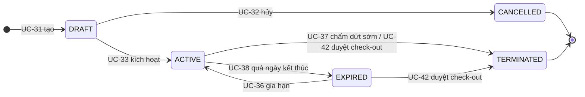

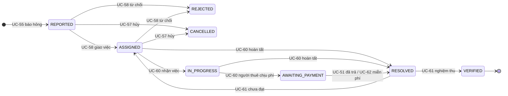
